<!-- generated by scripts/build_pages.py from data/sample_1_1/; edits are overwritten -->

Voxel size 0.4815 µm (cubic) · volume 116 × 512 × 512 voxels (z, y, x) = 56 × 247 × 247 µm ·
exported 2026-10-15 from `Texas red 20min_24.8.2026.lif`.

Downloads: [osteocyte_props.csv](../data/sample_1_1/osteocyte_props.csv) · [dendrites.csv](../data/sample_1_1/dendrites.csv) · [summary.log](../data/sample_1_1/summary.log) · [summary.json](../data/sample_1_1/summary.json) · [scene.glb](../data/sample_1_1/scene.glb) · [scene_obj.zip](../data/sample_1_1/scene_obj.zip)

## 3D scene

Drag to rotate, scroll to zoom, right-drag to pan. One colour per osteocyte; cleaned ch0 nuclei inside the hull
(bone side) in translucent blue. Depth (z) points up. `scene_obj.zip` has the same scene as OBJ + MTL in µm,
with and without the nuclei.

```{=html}
<button class="btn btn-sm btn-outline-secondary nuclei-toggle" aria-pressed="true" data-target="scene" data-opacity="0.35">Nuclei: shown</button>
<model-viewer id="scene" src="../data/sample_1_1/scene.glb" alt="sample 1.1 osteocytes and nuclei" camera-controls touch-action="pan-y" interaction-prompt="none" shadow-intensity="0" exposure="1.1" class="scene-viewer" camera-orbit="0deg 35deg auto"></model-viewer>
```

## Pipeline counts

| stage | count |
|:--|--:|
| watershed regions | 164 |
| &gt;= 100 voxels and &gt; 1 vox inside xy hull (pass 1) | 111 |
| &gt; 0 vox inside hull without soft tissue (pass 2) | 97 |
| removed: far side of soft tissue | 1 |
| removed: no nucleus | 43 |
| split by nuclei | 4 |
| removed: flat | 7 |
| surviving osteocytes | 51 |
| nuclei (cleaned ch0) | 104 |
| inside hull, bone side | 95 |
| detected | 46 |
| soft tissue | 7 |
| labelled, rejected | 21 |
| no ch1 label | 21 |
| inside hull, not labelled as osteocyte (rejected + no ch1) | 42 |
| protrusions reaching &gt;= 2.0 µm | 370 |
| dendrites (rods, counted) | 364 |
| flat parts of the body (sheets, not counted) | 6 |

## Osteocytes

```{=html}
<table class="datatable">
<thead><tr><th>label</th><th>volume (µm³)</th><th>surface (µm²)</th><th>axis 1 (µm)</th><th>axis 2 (µm)</th><th>axis 3 (µm)</th><th>flatness</th><th>nuclei</th><th>nucleus (µm³)</th><th>dendrites</th><th>reach mean (µm)</th><th>reach sd (µm)</th><th>reach max (µm)</th><th>path mean (µm)</th></tr></thead>
<tbody>
<tr><td>2</td><td>1298</td><td>1680</td><td>34.43</td><td>16.71</td><td>13.81</td><td>0.83</td><td>1</td><td>85.27</td><td>5</td><td>3.10</td><td>2.16</td><td>6.96</td><td>6.31</td></tr>
<tr><td>3</td><td>2502</td><td>3783</td><td>75.66</td><td>33.78</td><td>9.30</td><td>0.28</td><td>1</td><td>139</td><td>16</td><td>3.26</td><td>0.89</td><td>5.19</td><td>10.35</td></tr>
<tr><td>5</td><td>2796</td><td>3307</td><td>52.15</td><td>27.23</td><td>7.23</td><td>0.27</td><td>1</td><td>227</td><td>8</td><td>3.14</td><td>1.60</td><td>6.96</td><td>15.60</td></tr>
<tr><td>15</td><td>1429</td><td>2362</td><td>40.34</td><td>23.28</td><td>6.65</td><td>0.29</td><td>1</td><td>55.02</td><td>9</td><td>5.76</td><td>3.79</td><td>15.07</td><td>16.70</td></tr>
<tr><td>19</td><td>1007</td><td>1518</td><td>39.38</td><td>14.37</td><td>7.43</td><td>0.52</td><td>1</td><td>34.15</td><td>2</td><td>6.85</td><td>5.33</td><td>10.61</td><td>21.45</td></tr>
<tr><td>23</td><td>137</td><td>277</td><td>14.89</td><td>7.21</td><td>4.99</td><td>0.69</td><td>0</td><td>60.61</td><td>0</td><td></td><td></td><td></td><td></td></tr>
<tr><td>24</td><td>744</td><td>971</td><td>33.43</td><td>11.47</td><td>5.05</td><td>0.44</td><td>1</td><td>45.87</td><td>2</td><td>2.28</td><td>0.11</td><td>2.36</td><td>2.70</td></tr>
<tr><td>26</td><td>1085</td><td>1646</td><td>38.27</td><td>19.76</td><td>7.82</td><td>0.40</td><td>0</td><td>99.33</td><td>3</td><td>3.08</td><td>0.54</td><td>3.40</td><td>8.08</td></tr>
<tr><td>27</td><td>1672</td><td>2151</td><td>39.14</td><td>15.31</td><td>11.52</td><td>0.75</td><td>1</td><td>52.46</td><td>11</td><td>7.84</td><td>6.16</td><td>19.82</td><td>11.11</td></tr>
<tr><td>29</td><td>695</td><td>1114</td><td>39.17</td><td>14.91</td><td>8.50</td><td>0.57</td><td>1</td><td>40.29</td><td>14</td><td>4.64</td><td>4.38</td><td>15.98</td><td>3.67</td></tr>
<tr><td>32</td><td>1048</td><td>1553</td><td>32.81</td><td>19.85</td><td>6.51</td><td>0.33</td><td>1</td><td>43.98</td><td>8</td><td>3.56</td><td>1.43</td><td>5.30</td><td>7.90</td></tr>
<tr><td>33</td><td>2194</td><td>3052</td><td>42.68</td><td>19.55</td><td>14.09</td><td>0.72</td><td>1</td><td>39.62</td><td>19</td><td>6.25</td><td>4.46</td><td>17.87</td><td>10.17</td></tr>
<tr><td>34</td><td>1865</td><td>1858</td><td>24.82</td><td>19.03</td><td>12.35</td><td>0.65</td><td>1</td><td>43.98</td><td>7</td><td>4.51</td><td>2.80</td><td>10.13</td><td>5.46</td></tr>
<tr><td>36</td><td>1161</td><td>1784</td><td>47.25</td><td>16.16</td><td>7.19</td><td>0.45</td><td>1</td><td>51.45</td><td>6</td><td>5.11</td><td>2.75</td><td>9.84</td><td>25.20</td></tr>
<tr><td>37</td><td>2530</td><td>3194</td><td>39.35</td><td>23.53</td><td>11.58</td><td>0.49</td><td>1</td><td>43.08</td><td>19</td><td>5.56</td><td>4.11</td><td>20.24</td><td>11.47</td></tr>
<tr><td>45</td><td>1114</td><td>921</td><td>18.85</td><td>13.92</td><td>10.23</td><td>0.74</td><td>1</td><td>305</td><td>0</td><td></td><td></td><td></td><td></td></tr>
<tr><td>46</td><td>1145</td><td>1585</td><td>41.83</td><td>18.20</td><td>5.97</td><td>0.33</td><td>1</td><td>114</td><td>5</td><td>6.04</td><td>3.22</td><td>10.73</td><td>11.49</td></tr>
<tr><td>49</td><td>832</td><td>1181</td><td>35.97</td><td>12.80</td><td>7.68</td><td>0.60</td><td>1</td><td>44.53</td><td>4</td><td>8.18</td><td>5.28</td><td>13.39</td><td>13.28</td></tr>
<tr><td>59</td><td>2133</td><td>2601</td><td>65.01</td><td>18.31</td><td>5.30</td><td>0.29</td><td>1</td><td>265</td><td>8</td><td>3.78</td><td>1.99</td><td>7.55</td><td>11.30</td></tr>
<tr><td>62</td><td>173</td><td>308</td><td>15.95</td><td>9.65</td><td>2.64</td><td>0.27</td><td>1</td><td>27.90</td><td>2</td><td>2.82</td><td>1.02</td><td>3.54</td><td>11.40</td></tr>
<tr><td>64</td><td>1349</td><td>1908</td><td>36.77</td><td>18.30</td><td>8.94</td><td>0.49</td><td>1</td><td>55.14</td><td>10</td><td>4.08</td><td>3.01</td><td>11.35</td><td>12.21</td></tr>
<tr><td>69</td><td>415</td><td>570</td><td>22.65</td><td>10.60</td><td>5.88</td><td>0.56</td><td>1</td><td>33.60</td><td>4</td><td>6.78</td><td>3.84</td><td>12.08</td><td>5.75</td></tr>
<tr><td>71</td><td>1246</td><td>1392</td><td>38.54</td><td>13.63</td><td>6.20</td><td>0.46</td><td>1</td><td>77.46</td><td>3</td><td>2.49</td><td>0.41</td><td>2.85</td><td>2.68</td></tr>
<tr><td>82</td><td>169</td><td>317</td><td>18.87</td><td>6.25</td><td>3.26</td><td>0.52</td><td>1</td><td>38.17</td><td>2</td><td>2.85</td><td>0.98</td><td>3.54</td><td>5.25</td></tr>
<tr><td>84</td><td>880</td><td>881</td><td>26.55</td><td>9.97</td><td>8.45</td><td>0.85</td><td>1</td><td>103</td><td>3</td><td>2.43</td><td>0.29</td><td>2.72</td><td>3.82</td></tr>
<tr><td>85</td><td>1364</td><td>1819</td><td>32.47</td><td>16.78</td><td>9.82</td><td>0.59</td><td>1</td><td>86.39</td><td>10</td><td>4.04</td><td>4.40</td><td>16.43</td><td>7.11</td></tr>
<tr><td>86</td><td>564</td><td>669</td><td>28.64</td><td>8.56</td><td>5.40</td><td>0.63</td><td>1</td><td>33.26</td><td>4</td><td>3.53</td><td>0.87</td><td>4.79</td><td>2.03</td></tr>
<tr><td>88</td><td>386</td><td>610</td><td>31.83</td><td>8.12</td><td>5.23</td><td>0.64</td><td>1</td><td>33.48</td><td>3</td><td>5.04</td><td>2.50</td><td>6.55</td><td>3.70</td></tr>
<tr><td>96</td><td>1120</td><td>1329</td><td>17.89</td><td>14.82</td><td>12.22</td><td>0.82</td><td>1</td><td>33.82</td><td>8</td><td>4.23</td><td>1.64</td><td>7.01</td><td>8.85</td></tr>
<tr><td>105</td><td>1417</td><td>1742</td><td>23.67</td><td>16.36</td><td>12.93</td><td>0.79</td><td>1</td><td>62.95</td><td>9</td><td>3.28</td><td>0.93</td><td>4.79</td><td>7.92</td></tr>
<tr><td>106</td><td>386</td><td>585</td><td>23.55</td><td>9.10</td><td>4.92</td><td>0.54</td><td>1</td><td>35.16</td><td>4</td><td>5.37</td><td>1.96</td><td>7.27</td><td>7.65</td></tr>
<tr><td>110</td><td>918</td><td>1271</td><td>30.10</td><td>15.27</td><td>6.04</td><td>0.40</td><td>1</td><td>28.35</td><td>4</td><td>4.22</td><td>0.87</td><td>5.32</td><td>16.34</td></tr>
<tr><td>111</td><td>1280</td><td>1502</td><td>30.83</td><td>10.86</td><td>10.05</td><td>0.93</td><td>1</td><td>36.05</td><td>10</td><td>4.38</td><td>2.31</td><td>9.59</td><td>7.49</td></tr>
<tr><td>116</td><td>1088</td><td>1269</td><td>25.71</td><td>13.39</td><td>8.50</td><td>0.63</td><td>1</td><td>26.79</td><td>7</td><td>4.53</td><td>2.06</td><td>8.57</td><td>7.50</td></tr>
<tr><td>119</td><td>702</td><td>973</td><td>28.48</td><td>11.18</td><td>9.71</td><td>0.87</td><td>1</td><td>30.25</td><td>7</td><td>3.23</td><td>1.17</td><td>5.16</td><td>6.72</td></tr>
<tr><td>130</td><td>3118</td><td>3059</td><td>42.44</td><td>21.57</td><td>13.22</td><td>0.61</td><td>1</td><td>22.66</td><td>8</td><td>3.22</td><td>1.48</td><td>6.50</td><td>7.95</td></tr>
<tr><td>141</td><td>4689</td><td>4581</td><td>43.26</td><td>33.91</td><td>12.31</td><td>0.36</td><td>1</td><td>59.04</td><td>13</td><td>4.10</td><td>1.86</td><td>9.08</td><td>11.36</td></tr>
<tr><td>142</td><td>602</td><td>1176</td><td>22.74</td><td>13.13</td><td>8.58</td><td>0.65</td><td>1</td><td>79.13</td><td>3</td><td>3.78</td><td>0.86</td><td>4.64</td><td>33.06</td></tr>
<tr><td>146</td><td>1863</td><td>2605</td><td>47.06</td><td>21.26</td><td>7.76</td><td>0.37</td><td>1</td><td>27.12</td><td>5</td><td>3.72</td><td>1.65</td><td>6.50</td><td>15.48</td></tr>
<tr><td>150</td><td>1629</td><td>2201</td><td>26.59</td><td>22.46</td><td>9.41</td><td>0.42</td><td>1</td><td>24.78</td><td>10</td><td>3.20</td><td>1.10</td><td>5.30</td><td>10.87</td></tr>
<tr><td>151</td><td>4360</td><td>3970</td><td>38.00</td><td>25.32</td><td>14.40</td><td>0.57</td><td>1</td><td>89.07</td><td>13</td><td>3.88</td><td>1.91</td><td>9.11</td><td>6.91</td></tr>
<tr><td>154</td><td>4369</td><td>5689</td><td>62.26</td><td>32.18</td><td>14.42</td><td>0.45</td><td>1</td><td>25.45</td><td>14</td><td>3.63</td><td>2.17</td><td>9.27</td><td>19.09</td></tr>
<tr><td>156</td><td>3812</td><td>4160</td><td>49.93</td><td>19.71</td><td>13.78</td><td>0.70</td><td>1</td><td>24.33</td><td>14</td><td>3.35</td><td>1.68</td><td>7.47</td><td>14.89</td></tr>
<tr><td>182</td><td>1532</td><td>1809</td><td>22.64</td><td>19.02</td><td>10.67</td><td>0.56</td><td>1</td><td>24.67</td><td>5</td><td>3.72</td><td>1.59</td><td>5.72</td><td>18.98</td></tr>
<tr><td>190</td><td>2573</td><td>2678</td><td>34.24</td><td>20.22</td><td>10.76</td><td>0.53</td><td>1</td><td>45.87</td><td>7</td><td>2.50</td><td>0.41</td><td>3.23</td><td>7.97</td></tr>
<tr><td>206</td><td>2966</td><td>3332</td><td>37.69</td><td>26.55</td><td>11.52</td><td>0.43</td><td>1</td><td>67.08</td><td>10</td><td>3.53</td><td>1.80</td><td>7.84</td><td>19.35</td></tr>
<tr><td>227</td><td>91.74</td><td>146</td><td>6.82</td><td>6.02</td><td>5.52</td><td>0.92</td><td>0</td><td>50.45</td><td>0</td><td></td><td></td><td></td><td></td></tr>
<tr><td>228</td><td>936</td><td>1254</td><td>18.15</td><td>17.82</td><td>12.38</td><td>0.69</td><td>1</td><td>99.22</td><td>5</td><td>2.71</td><td>0.53</td><td>3.40</td><td>3.30</td></tr>
<tr><td>229</td><td>991</td><td>1317</td><td>29.30</td><td>12.80</td><td>11.18</td><td>0.87</td><td>1</td><td>72.66</td><td>5</td><td>3.84</td><td>1.65</td><td>6.26</td><td>6.32</td></tr>
<tr><td>230</td><td>915</td><td>1466</td><td>28.11</td><td>21.17</td><td>6.06</td><td>0.29</td><td>0</td><td>77.12</td><td>10</td><td>4.17</td><td>1.48</td><td>7.09</td><td>10.44</td></tr>
<tr><td>231</td><td>1881</td><td>2173</td><td>42.13</td><td>14.04</td><td>12.57</td><td>0.90</td><td>0</td><td>35.60</td><td>6</td><td>3.12</td><td>1.10</td><td>4.54</td><td>6.36</td></tr>
</tbody>
</table>
```

## Gallery

Rotating maximum-intensity projections of ch1 inside each osteocyte. Click a cell for its 3D mesh and the
check of its dendrite count: ch1 inside the cell (left) beside the detection (right) as a depth-shaded surface,
rotating, with the cell body grey, counted dendrites blue, flat parts of the body green and short protrusions orange.

```{=html}
<div class="gallery">
<figure class="cell-card" data-glb="../data/sample_1_1/cells/osteocyte_2.glb" data-validation="../data/sample_1_1/cells/osteocyte_2_dendrites" data-title="osteocyte 2: 5 dendrites">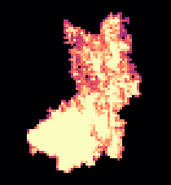<figcaption>#2 · 1298 µm³ · 5 dendrites</figcaption></figure>
<figure class="cell-card" data-glb="../data/sample_1_1/cells/osteocyte_3.glb" data-validation="../data/sample_1_1/cells/osteocyte_3_dendrites" data-title="osteocyte 3: 16 dendrites">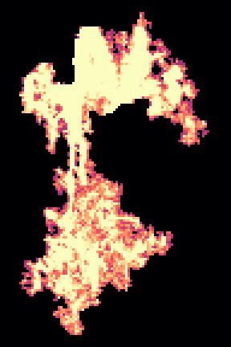<figcaption>#3 · 2502 µm³ · 16 dendrites</figcaption></figure>
<figure class="cell-card" data-glb="../data/sample_1_1/cells/osteocyte_5.glb" data-validation="../data/sample_1_1/cells/osteocyte_5_dendrites" data-title="osteocyte 5: 8 dendrites">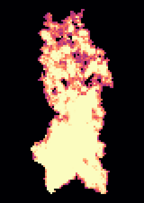<figcaption>#5 · 2796 µm³ · 8 dendrites</figcaption></figure>
<figure class="cell-card" data-glb="../data/sample_1_1/cells/osteocyte_15.glb" data-validation="../data/sample_1_1/cells/osteocyte_15_dendrites" data-title="osteocyte 15: 9 dendrites">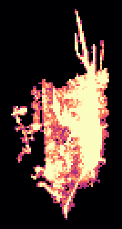<figcaption>#15 · 1429 µm³ · 9 dendrites</figcaption></figure>
<figure class="cell-card" data-glb="../data/sample_1_1/cells/osteocyte_19.glb" data-validation="../data/sample_1_1/cells/osteocyte_19_dendrites" data-title="osteocyte 19: 2 dendrites">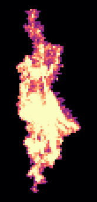<figcaption>#19 · 1007 µm³ · 2 dendrites</figcaption></figure>
<figure class="cell-card" data-glb="../data/sample_1_1/cells/osteocyte_23.glb" data-validation="../data/sample_1_1/cells/osteocyte_23_dendrites" data-title="osteocyte 23: 0 dendrites">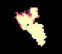<figcaption>#23 · 137 µm³ · 0 dendrites</figcaption></figure>
<figure class="cell-card" data-glb="../data/sample_1_1/cells/osteocyte_24.glb" data-validation="../data/sample_1_1/cells/osteocyte_24_dendrites" data-title="osteocyte 24: 2 dendrites">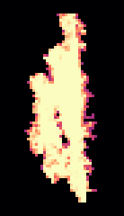<figcaption>#24 · 744 µm³ · 2 dendrites</figcaption></figure>
<figure class="cell-card" data-glb="../data/sample_1_1/cells/osteocyte_26.glb" data-validation="../data/sample_1_1/cells/osteocyte_26_dendrites" data-title="osteocyte 26: 3 dendrites">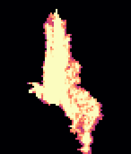<figcaption>#26 · 1085 µm³ · 3 dendrites</figcaption></figure>
<figure class="cell-card" data-glb="../data/sample_1_1/cells/osteocyte_27.glb" data-validation="../data/sample_1_1/cells/osteocyte_27_dendrites" data-title="osteocyte 27: 11 dendrites"><figcaption>#27 · 1672 µm³ · 11 dendrites</figcaption></figure>
<figure class="cell-card" data-glb="../data/sample_1_1/cells/osteocyte_29.glb" data-validation="../data/sample_1_1/cells/osteocyte_29_dendrites" data-title="osteocyte 29: 14 dendrites"><figcaption>#29 · 695 µm³ · 14 dendrites</figcaption></figure>
<figure class="cell-card" data-glb="../data/sample_1_1/cells/osteocyte_32.glb" data-validation="../data/sample_1_1/cells/osteocyte_32_dendrites" data-title="osteocyte 32: 8 dendrites">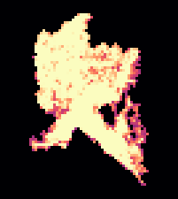<figcaption>#32 · 1048 µm³ · 8 dendrites</figcaption></figure>
<figure class="cell-card" data-glb="../data/sample_1_1/cells/osteocyte_33.glb" data-validation="../data/sample_1_1/cells/osteocyte_33_dendrites" data-title="osteocyte 33: 19 dendrites">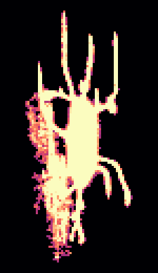<figcaption>#33 · 2194 µm³ · 19 dendrites</figcaption></figure>
<figure class="cell-card" data-glb="../data/sample_1_1/cells/osteocyte_34.glb" data-validation="../data/sample_1_1/cells/osteocyte_34_dendrites" data-title="osteocyte 34: 7 dendrites"><figcaption>#34 · 1865 µm³ · 7 dendrites</figcaption></figure>
<figure class="cell-card" data-glb="../data/sample_1_1/cells/osteocyte_36.glb" data-validation="../data/sample_1_1/cells/osteocyte_36_dendrites" data-title="osteocyte 36: 6 dendrites">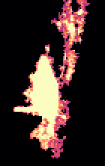<figcaption>#36 · 1161 µm³ · 6 dendrites</figcaption></figure>
<figure class="cell-card" data-glb="../data/sample_1_1/cells/osteocyte_37.glb" data-validation="../data/sample_1_1/cells/osteocyte_37_dendrites" data-title="osteocyte 37: 19 dendrites"><figcaption>#37 · 2530 µm³ · 19 dendrites</figcaption></figure>
<figure class="cell-card" data-glb="../data/sample_1_1/cells/osteocyte_45.glb" data-validation="../data/sample_1_1/cells/osteocyte_45_dendrites" data-title="osteocyte 45: 0 dendrites">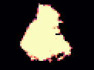<figcaption>#45 · 1114 µm³ · 0 dendrites</figcaption></figure>
<figure class="cell-card" data-glb="../data/sample_1_1/cells/osteocyte_46.glb" data-validation="../data/sample_1_1/cells/osteocyte_46_dendrites" data-title="osteocyte 46: 5 dendrites">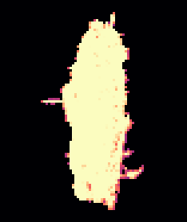<figcaption>#46 · 1145 µm³ · 5 dendrites</figcaption></figure>
<figure class="cell-card" data-glb="../data/sample_1_1/cells/osteocyte_49.glb" data-validation="../data/sample_1_1/cells/osteocyte_49_dendrites" data-title="osteocyte 49: 4 dendrites"><figcaption>#49 · 832 µm³ · 4 dendrites</figcaption></figure>
<figure class="cell-card" data-glb="../data/sample_1_1/cells/osteocyte_59.glb" data-validation="../data/sample_1_1/cells/osteocyte_59_dendrites" data-title="osteocyte 59: 8 dendrites">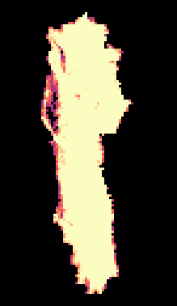<figcaption>#59 · 2133 µm³ · 8 dendrites</figcaption></figure>
<figure class="cell-card" data-glb="../data/sample_1_1/cells/osteocyte_62.glb" data-validation="../data/sample_1_1/cells/osteocyte_62_dendrites" data-title="osteocyte 62: 2 dendrites"><figcaption>#62 · 173 µm³ · 2 dendrites</figcaption></figure>
<figure class="cell-card" data-glb="../data/sample_1_1/cells/osteocyte_64.glb" data-validation="../data/sample_1_1/cells/osteocyte_64_dendrites" data-title="osteocyte 64: 10 dendrites"><figcaption>#64 · 1349 µm³ · 10 dendrites</figcaption></figure>
<figure class="cell-card" data-glb="../data/sample_1_1/cells/osteocyte_69.glb" data-validation="../data/sample_1_1/cells/osteocyte_69_dendrites" data-title="osteocyte 69: 4 dendrites"><figcaption>#69 · 415 µm³ · 4 dendrites</figcaption></figure>
<figure class="cell-card" data-glb="../data/sample_1_1/cells/osteocyte_71.glb" data-validation="../data/sample_1_1/cells/osteocyte_71_dendrites" data-title="osteocyte 71: 3 dendrites">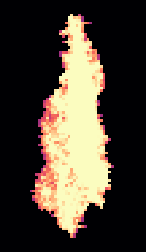<figcaption>#71 · 1246 µm³ · 3 dendrites</figcaption></figure>
<figure class="cell-card" data-glb="../data/sample_1_1/cells/osteocyte_82.glb" data-validation="../data/sample_1_1/cells/osteocyte_82_dendrites" data-title="osteocyte 82: 2 dendrites">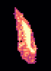<figcaption>#82 · 169 µm³ · 2 dendrites</figcaption></figure>
<figure class="cell-card" data-glb="../data/sample_1_1/cells/osteocyte_84.glb" data-validation="../data/sample_1_1/cells/osteocyte_84_dendrites" data-title="osteocyte 84: 3 dendrites"><figcaption>#84 · 880 µm³ · 3 dendrites</figcaption></figure>
<figure class="cell-card" data-glb="../data/sample_1_1/cells/osteocyte_85.glb" data-validation="../data/sample_1_1/cells/osteocyte_85_dendrites" data-title="osteocyte 85: 10 dendrites"><figcaption>#85 · 1364 µm³ · 10 dendrites</figcaption></figure>
<figure class="cell-card" data-glb="../data/sample_1_1/cells/osteocyte_86.glb" data-validation="../data/sample_1_1/cells/osteocyte_86_dendrites" data-title="osteocyte 86: 4 dendrites"><figcaption>#86 · 564 µm³ · 4 dendrites</figcaption></figure>
<figure class="cell-card" data-glb="../data/sample_1_1/cells/osteocyte_88.glb" data-validation="../data/sample_1_1/cells/osteocyte_88_dendrites" data-title="osteocyte 88: 3 dendrites"><figcaption>#88 · 386 µm³ · 3 dendrites</figcaption></figure>
<figure class="cell-card" data-glb="../data/sample_1_1/cells/osteocyte_96.glb" data-validation="../data/sample_1_1/cells/osteocyte_96_dendrites" data-title="osteocyte 96: 8 dendrites">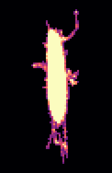<figcaption>#96 · 1120 µm³ · 8 dendrites</figcaption></figure>
<figure class="cell-card" data-glb="../data/sample_1_1/cells/osteocyte_105.glb" data-validation="../data/sample_1_1/cells/osteocyte_105_dendrites" data-title="osteocyte 105: 9 dendrites">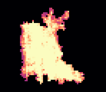<figcaption>#105 · 1417 µm³ · 9 dendrites</figcaption></figure>
<figure class="cell-card" data-glb="../data/sample_1_1/cells/osteocyte_106.glb" data-validation="../data/sample_1_1/cells/osteocyte_106_dendrites" data-title="osteocyte 106: 4 dendrites">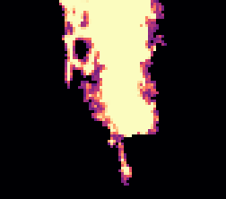<figcaption>#106 · 386 µm³ · 4 dendrites</figcaption></figure>
<figure class="cell-card" data-glb="../data/sample_1_1/cells/osteocyte_110.glb" data-validation="../data/sample_1_1/cells/osteocyte_110_dendrites" data-title="osteocyte 110: 4 dendrites"><figcaption>#110 · 918 µm³ · 4 dendrites</figcaption></figure>
<figure class="cell-card" data-glb="../data/sample_1_1/cells/osteocyte_111.glb" data-validation="../data/sample_1_1/cells/osteocyte_111_dendrites" data-title="osteocyte 111: 10 dendrites"><figcaption>#111 · 1280 µm³ · 10 dendrites</figcaption></figure>
<figure class="cell-card" data-glb="../data/sample_1_1/cells/osteocyte_116.glb" data-validation="../data/sample_1_1/cells/osteocyte_116_dendrites" data-title="osteocyte 116: 7 dendrites"><figcaption>#116 · 1088 µm³ · 7 dendrites</figcaption></figure>
<figure class="cell-card" data-glb="../data/sample_1_1/cells/osteocyte_119.glb" data-validation="../data/sample_1_1/cells/osteocyte_119_dendrites" data-title="osteocyte 119: 7 dendrites"><figcaption>#119 · 702 µm³ · 7 dendrites</figcaption></figure>
<figure class="cell-card" data-glb="../data/sample_1_1/cells/osteocyte_130.glb" data-validation="../data/sample_1_1/cells/osteocyte_130_dendrites" data-title="osteocyte 130: 8 dendrites">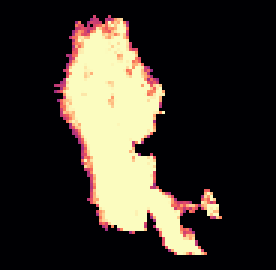<figcaption>#130 · 3118 µm³ · 8 dendrites</figcaption></figure>
<figure class="cell-card" data-glb="../data/sample_1_1/cells/osteocyte_141.glb" data-validation="../data/sample_1_1/cells/osteocyte_141_dendrites" data-title="osteocyte 141: 13 dendrites">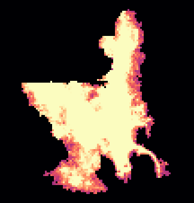<figcaption>#141 · 4689 µm³ · 13 dendrites</figcaption></figure>
<figure class="cell-card" data-glb="../data/sample_1_1/cells/osteocyte_142.glb" data-validation="../data/sample_1_1/cells/osteocyte_142_dendrites" data-title="osteocyte 142: 3 dendrites">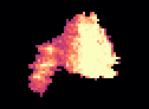<figcaption>#142 · 602 µm³ · 3 dendrites</figcaption></figure>
<figure class="cell-card" data-glb="../data/sample_1_1/cells/osteocyte_146.glb" data-validation="../data/sample_1_1/cells/osteocyte_146_dendrites" data-title="osteocyte 146: 5 dendrites">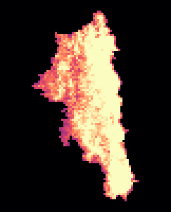<figcaption>#146 · 1863 µm³ · 5 dendrites</figcaption></figure>
<figure class="cell-card" data-glb="../data/sample_1_1/cells/osteocyte_150.glb" data-validation="../data/sample_1_1/cells/osteocyte_150_dendrites" data-title="osteocyte 150: 10 dendrites">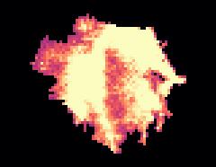<figcaption>#150 · 1629 µm³ · 10 dendrites</figcaption></figure>
<figure class="cell-card" data-glb="../data/sample_1_1/cells/osteocyte_151.glb" data-validation="../data/sample_1_1/cells/osteocyte_151_dendrites" data-title="osteocyte 151: 13 dendrites">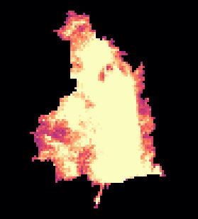<figcaption>#151 · 4360 µm³ · 13 dendrites</figcaption></figure>
<figure class="cell-card" data-glb="../data/sample_1_1/cells/osteocyte_154.glb" data-validation="../data/sample_1_1/cells/osteocyte_154_dendrites" data-title="osteocyte 154: 14 dendrites">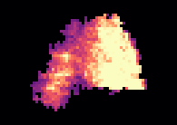<figcaption>#154 · 4369 µm³ · 14 dendrites</figcaption></figure>
<figure class="cell-card" data-glb="../data/sample_1_1/cells/osteocyte_156.glb" data-validation="../data/sample_1_1/cells/osteocyte_156_dendrites" data-title="osteocyte 156: 14 dendrites"><figcaption>#156 · 3812 µm³ · 14 dendrites</figcaption></figure>
<figure class="cell-card" data-glb="../data/sample_1_1/cells/osteocyte_182.glb" data-validation="../data/sample_1_1/cells/osteocyte_182_dendrites" data-title="osteocyte 182: 5 dendrites">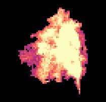<figcaption>#182 · 1532 µm³ · 5 dendrites</figcaption></figure>
<figure class="cell-card" data-glb="../data/sample_1_1/cells/osteocyte_190.glb" data-validation="../data/sample_1_1/cells/osteocyte_190_dendrites" data-title="osteocyte 190: 7 dendrites">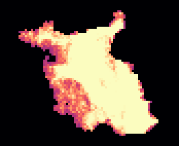<figcaption>#190 · 2573 µm³ · 7 dendrites</figcaption></figure>
<figure class="cell-card" data-glb="../data/sample_1_1/cells/osteocyte_206.glb" data-validation="../data/sample_1_1/cells/osteocyte_206_dendrites" data-title="osteocyte 206: 10 dendrites">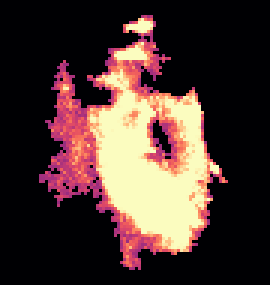<figcaption>#206 · 2966 µm³ · 10 dendrites</figcaption></figure>
<figure class="cell-card" data-glb="../data/sample_1_1/cells/osteocyte_227.glb" data-validation="../data/sample_1_1/cells/osteocyte_227_dendrites" data-title="osteocyte 227: 0 dendrites"><figcaption>#227 · 91.74 µm³ · 0 dendrites</figcaption></figure>
<figure class="cell-card" data-glb="../data/sample_1_1/cells/osteocyte_228.glb" data-validation="../data/sample_1_1/cells/osteocyte_228_dendrites" data-title="osteocyte 228: 5 dendrites"><figcaption>#228 · 936 µm³ · 5 dendrites</figcaption></figure>
<figure class="cell-card" data-glb="../data/sample_1_1/cells/osteocyte_229.glb" data-validation="../data/sample_1_1/cells/osteocyte_229_dendrites" data-title="osteocyte 229: 5 dendrites">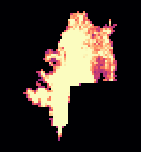<figcaption>#229 · 991 µm³ · 5 dendrites</figcaption></figure>
<figure class="cell-card" data-glb="../data/sample_1_1/cells/osteocyte_230.glb" data-validation="../data/sample_1_1/cells/osteocyte_230_dendrites" data-title="osteocyte 230: 10 dendrites"><figcaption>#230 · 915 µm³ · 10 dendrites</figcaption></figure>
<figure class="cell-card" data-glb="../data/sample_1_1/cells/osteocyte_231.glb" data-validation="../data/sample_1_1/cells/osteocyte_231_dendrites" data-title="osteocyte 231: 6 dendrites"><figcaption>#231 · 1881 µm³ · 6 dendrites</figcaption></figure>
</div>
<dialog id="cell-dialog"><form method="dialog"><button class="close" aria-label="close">×</button></form>
<h3 class="cell-title"></h3>
<div class="cell-panels">
<model-viewer camera-controls interaction-prompt="none" shadow-intensity="0" class="cell-viewer"></model-viewer>
<figure class="cell-validation">
<figcaption><span class="key" style="--c:#9a9893"></span>body <span class="key" style="--c:#2a78d6"></span>dendrite (counted)
<span class="key" style="--c:#1baf7a"></span>flat part of the body <span class="key" style="--c:#eb6834"></span>short protrusion
· <a class="validation-png" target="_blank">projections (PNG)</a></figcaption></figure>
</div></dialog>
```
