<!-- generated by scripts/build_pages.py from data/sample_1_1/; edits are overwritten -->

Voxel size 0.4815 µm (cubic) · volume 116 × 512 × 512 voxels (z, y, x) = 56 × 247 × 247 µm ·
exported 2026-10-07 from `Texas red 20min_24.8.2026.lif`.

Downloads: [osteocyte_props.csv](../data/sample_1_1/osteocyte_props.csv) · [dendrites.csv](../data/sample_1_1/dendrites.csv) · [summary.log](../data/sample_1_1/summary.log) · [summary.json](../data/sample_1_1/summary.json) · [scene.glb](../data/sample_1_1/scene.glb) · [scene_obj.zip](../data/sample_1_1/scene_obj.zip)

## 3D scene

Drag to rotate, scroll to zoom, right-drag to pan. One colour per osteocyte; cleaned ch0 nuclei inside the hull
(bone side) in translucent blue. Depth (z) points up. `scene_obj.zip` has the same scene as OBJ + MTL in µm,
with and without the nuclei.

```{=html}
<button class="btn btn-sm btn-outline-secondary nuclei-toggle" aria-pressed="true" data-target="scene" data-opacity="0.35">Nuclei: shown</button>
<model-viewer id="scene" src="../data/sample_1_1/scene.glb" alt="sample 1.1 osteocytes and nuclei" camera-controls touch-action="pan-y" interaction-prompt="none" shadow-intensity="0" exposure="1.1" class="scene-viewer" camera-orbit="0deg 35deg auto"></model-viewer>
```

## Pipeline counts

| stage | count |
|:--|--:|
| watershed regions | 181 |
| &gt;= 100 voxels and &gt; 5 vox inside xy hull (pass 1) | 118 |
| &gt; 0 vox inside hull without soft tissue (pass 2) | 107 |
| removed: far side of soft tissue | 5 |
| removed: no nucleus | 46 |
| split by nuclei | 1 |
| removed: flat | 16 |
| surviving osteocytes | 41 |
| nuclei (cleaned ch0) | 110 |
| inside hull, bone side | 91 |
| detected | 39 |
| soft tissue | 8 |
| labelled, rejected | 23 |
| no ch1 label | 21 |
| inside hull, not labelled as osteocyte (rejected + no ch1) | 44 |

## Osteocytes

```{=html}
<table class="datatable">
<thead><tr><th>label</th><th>volume (µm³)</th><th>surface (µm²)</th><th>axis 1 (µm)</th><th>axis 2 (µm)</th><th>axis 3 (µm)</th><th>flatness</th><th>nuclei</th><th>nucleus (µm³)</th><th>dendrites</th><th>reach mean (µm)</th><th>reach sd (µm)</th><th>reach max (µm)</th><th>path mean (µm)</th></tr></thead>
<tbody>
<tr><td>2</td><td>1692</td><td>1827</td><td>35.84</td><td>17.10</td><td>14.02</td><td>0.82</td><td>1</td><td>79.47</td><td>1</td><td>2.04</td><td></td><td>2.04</td><td>0</td></tr>
<tr><td>14</td><td>1157</td><td>1452</td><td>41.81</td><td>10.20</td><td>7.52</td><td>0.74</td><td>1</td><td>47.55</td><td>4</td><td>5.27</td><td>4.70</td><td>12.31</td><td>17.12</td></tr>
<tr><td>19</td><td>1366</td><td>1724</td><td>41.87</td><td>14.67</td><td>7.64</td><td>0.52</td><td>1</td><td>32.03</td><td>3</td><td>3.65</td><td>1.61</td><td>5.47</td><td>4.74</td></tr>
<tr><td>29</td><td>2192</td><td>2664</td><td>40.90</td><td>15.91</td><td>12.83</td><td>0.81</td><td>1</td><td>52.12</td><td>12</td><td>6.84</td><td>7.16</td><td>23.38</td><td>9.36</td></tr>
<tr><td>30</td><td>925</td><td>1401</td><td>40.04</td><td>15.40</td><td>9.09</td><td>0.59</td><td>1</td><td>40.07</td><td>12</td><td>5.03</td><td>4.54</td><td>15.98</td><td>4.23</td></tr>
<tr><td>34</td><td>2950</td><td>3826</td><td>44.05</td><td>20.48</td><td>14.75</td><td>0.72</td><td>1</td><td>39.62</td><td>16</td><td>5.84</td><td>4.55</td><td>17.74</td><td>11.15</td></tr>
<tr><td>35</td><td>2157</td><td>1946</td><td>24.79</td><td>17.72</td><td>12.94</td><td>0.73</td><td>1</td><td>43.53</td><td>4</td><td>5.51</td><td>2.82</td><td>9.20</td><td>5.85</td></tr>
<tr><td>38</td><td>1227</td><td>1391</td><td>33.19</td><td>13.94</td><td>7.85</td><td>0.56</td><td>1</td><td>50.78</td><td>5</td><td>2.74</td><td>0.59</td><td>3.51</td><td>8.02</td></tr>
<tr><td>39</td><td>2964</td><td>3227</td><td>39.80</td><td>20.17</td><td>12.30</td><td>0.61</td><td>1</td><td>43.08</td><td>14</td><td>4.76</td><td>4.52</td><td>19.77</td><td>8.51</td></tr>
<tr><td>46</td><td>1270</td><td>1005</td><td>19.29</td><td>14.39</td><td>10.94</td><td>0.76</td><td>1</td><td>280</td><td>1</td><td>2.15</td><td></td><td>2.15</td><td>0.48</td></tr>
<tr><td>48</td><td>1499</td><td>2015</td><td>41.90</td><td>19.67</td><td>8.47</td><td>0.43</td><td>1</td><td>103</td><td>8</td><td>4.98</td><td>3.53</td><td>10.81</td><td>10.29</td></tr>
<tr><td>52</td><td>1153</td><td>1784</td><td>26.81</td><td>22.06</td><td>9.12</td><td>0.41</td><td>0</td><td>70.32</td><td>9</td><td>5.47</td><td>3.43</td><td>13.29</td><td>15.54</td></tr>
<tr><td>56</td><td>1060</td><td>1483</td><td>38.64</td><td>13.30</td><td>9.12</td><td>0.69</td><td>1</td><td>42.41</td><td>6</td><td>9.24</td><td>5.72</td><td>17.92</td><td>12.19</td></tr>
<tr><td>71</td><td>1934</td><td>2739</td><td>40.38</td><td>19.67</td><td>10.41</td><td>0.53</td><td>1</td><td>55.14</td><td>9</td><td>5.86</td><td>3.78</td><td>12.75</td><td>21.08</td></tr>
<tr><td>74</td><td>1201</td><td>1248</td><td>32.26</td><td>13.55</td><td>6.22</td><td>0.46</td><td>1</td><td>133</td><td>1</td><td>2.93</td><td></td><td>2.93</td><td>23.59</td></tr>
<tr><td>77</td><td>542</td><td>766</td><td>25.55</td><td>12.05</td><td>6.72</td><td>0.56</td><td>1</td><td>33.60</td><td>6</td><td>6.61</td><td>4.70</td><td>14.61</td><td>5.98</td></tr>
<tr><td>78</td><td>1033</td><td>1481</td><td>38.97</td><td>12.02</td><td>6.89</td><td>0.57</td><td>1</td><td>40.74</td><td>10</td><td>5.98</td><td>4.68</td><td>14.67</td><td>10.05</td></tr>
<tr><td>79</td><td>1594</td><td>1670</td><td>38.87</td><td>14.24</td><td>7.04</td><td>0.49</td><td>1</td><td>70.54</td><td>2</td><td>2.86</td><td>0.37</td><td>3.12</td><td>1.98</td></tr>
<tr><td>91</td><td>267</td><td>396</td><td>20.32</td><td>7.05</td><td>4.00</td><td>0.57</td><td>1</td><td>40.18</td><td>1</td><td>2.21</td><td></td><td>2.21</td><td>3.03</td></tr>
<tr><td>94</td><td>6580</td><td>5234</td><td>53.33</td><td>33.26</td><td>15.76</td><td>0.47</td><td>1</td><td>93.75</td><td>9</td><td>2.82</td><td>0.81</td><td>4.33</td><td>4.40</td></tr>
<tr><td>95</td><td>1089</td><td>1376</td><td>23.06</td><td>17.27</td><td>9.77</td><td>0.57</td><td>1</td><td>36.94</td><td>5</td><td>4.54</td><td>4.01</td><td>11.60</td><td>11.32</td></tr>
<tr><td>96</td><td>796</td><td>1122</td><td>33.18</td><td>11.80</td><td>6.88</td><td>0.58</td><td>1</td><td>32.48</td><td>7</td><td>5.95</td><td>3.51</td><td>12.34</td><td>11.40</td></tr>
<tr><td>98</td><td>599</td><td>1068</td><td>32.32</td><td>8.94</td><td>6.44</td><td>0.72</td><td>1</td><td>33.48</td><td>10</td><td>3.25</td><td>1.38</td><td>6.44</td><td>7.46</td></tr>
<tr><td>103</td><td>746</td><td>1111</td><td>36.68</td><td>9.42</td><td>6.21</td><td>0.66</td><td>1</td><td>38.73</td><td>5</td><td>5.26</td><td>5.99</td><td>15.95</td><td>16.05</td></tr>
<tr><td>106</td><td>2885</td><td>3126</td><td>35.81</td><td>21.39</td><td>13.89</td><td>0.65</td><td>1</td><td>33.82</td><td>12</td><td>3.87</td><td>2.61</td><td>11.45</td><td>11.45</td></tr>
<tr><td>117</td><td>1801</td><td>1884</td><td>23.51</td><td>17.65</td><td>14.03</td><td>0.80</td><td>1</td><td>58.37</td><td>5</td><td>2.81</td><td>0.46</td><td>3.47</td><td>2.75</td></tr>
<tr><td>118</td><td>537</td><td>781</td><td>25.15</td><td>9.83</td><td>5.91</td><td>0.60</td><td>1</td><td>35.16</td><td>5</td><td>5.06</td><td>2.07</td><td>6.81</td><td>7.60</td></tr>
<tr><td>121</td><td>1189</td><td>1529</td><td>31.76</td><td>16.55</td><td>6.64</td><td>0.40</td><td>1</td><td>28.35</td><td>4</td><td>3.53</td><td>0.94</td><td>4.41</td><td>14.96</td></tr>
<tr><td>122</td><td>1681</td><td>1999</td><td>34.02</td><td>12.09</td><td>10.91</td><td>0.90</td><td>1</td><td>36.05</td><td>8</td><td>5.84</td><td>4.62</td><td>15.65</td><td>13.08</td></tr>
<tr><td>127</td><td>1499</td><td>1769</td><td>31.85</td><td>14.31</td><td>9.90</td><td>0.69</td><td>1</td><td>26.79</td><td>8</td><td>6.32</td><td>5.64</td><td>19.32</td><td>12.88</td></tr>
<tr><td>147</td><td>253</td><td>437</td><td>22.06</td><td>7.13</td><td>4.03</td><td>0.57</td><td>1</td><td>23.22</td><td>2</td><td>3.12</td><td>0.94</td><td>3.79</td><td>9.14</td></tr>
<tr><td>154</td><td>893</td><td>1328</td><td>23.23</td><td>14.38</td><td>8.29</td><td>0.58</td><td>1</td><td>82.48</td><td>5</td><td>2.87</td><td>1.30</td><td>5.12</td><td>16.80</td></tr>
<tr><td>166</td><td>1626</td><td>2336</td><td>36.35</td><td>12.46</td><td>11.61</td><td>0.93</td><td>1</td><td>26.01</td><td>9</td><td>6.40</td><td>6.87</td><td>22.78</td><td>25.99</td></tr>
<tr><td>169</td><td>2177</td><td>2182</td><td>31.84</td><td>18.40</td><td>9.58</td><td>0.52</td><td>1</td><td>24.78</td><td>6</td><td>2.30</td><td>0.16</td><td>2.46</td><td>5.30</td></tr>
<tr><td>172</td><td>2327</td><td>2265</td><td>41.96</td><td>14.49</td><td>13.36</td><td>0.92</td><td>1</td><td>36.05</td><td>1</td><td>2.41</td><td></td><td>2.41</td><td>3.44</td></tr>
<tr><td>173</td><td>4768</td><td>4750</td><td>52.13</td><td>20.78</td><td>14.59</td><td>0.70</td><td>1</td><td>24.00</td><td>19</td><td>2.70</td><td>1.01</td><td>6.03</td><td>11.38</td></tr>
<tr><td>202</td><td>2503</td><td>2308</td><td>29.86</td><td>23.96</td><td>9.79</td><td>0.41</td><td>1</td><td>32.48</td><td>6</td><td>2.72</td><td>0.69</td><td>3.88</td><td>2.56</td></tr>
<tr><td>203</td><td>2135</td><td>2206</td><td>23.83</td><td>21.35</td><td>11.91</td><td>0.56</td><td>1</td><td>24.67</td><td>5</td><td>3.55</td><td>1.35</td><td>5.05</td><td>17.34</td></tr>
<tr><td>211</td><td>3186</td><td>2750</td><td>34.44</td><td>19.13</td><td>12.01</td><td>0.63</td><td>1</td><td>37.95</td><td>2</td><td>2.28</td><td>0.25</td><td>2.46</td><td>1.62</td></tr>
<tr><td>229</td><td>2123</td><td>2060</td><td>32.04</td><td>18.15</td><td>12.12</td><td>0.67</td><td>1</td><td>57.03</td><td>4</td><td>2.68</td><td>0.72</td><td>3.76</td><td>8.56</td></tr>
<tr><td>252</td><td>1094</td><td>1226</td><td>19.79</td><td>15.97</td><td>12.37</td><td>0.77</td><td>1</td><td>145</td><td>2</td><td>2.75</td><td>0.92</td><td>3.40</td><td>3.59</td></tr>
</tbody>
</table>
```

## Gallery

Rotating maximum-intensity projections of ch1 inside each osteocyte. Click a cell for its 3D mesh.

```{=html}
<div class="gallery">
<figure class="cell-card" data-glb="../data/sample_1_1/cells/osteocyte_2.glb" data-title="osteocyte 2"><figcaption>#2 · 1692 µm³ · 1 dendrites</figcaption></figure>
<figure class="cell-card" data-glb="../data/sample_1_1/cells/osteocyte_14.glb" data-title="osteocyte 14"><figcaption>#14 · 1157 µm³ · 4 dendrites</figcaption></figure>
<figure class="cell-card" data-glb="../data/sample_1_1/cells/osteocyte_19.glb" data-title="osteocyte 19"><figcaption>#19 · 1366 µm³ · 3 dendrites</figcaption></figure>
<figure class="cell-card" data-glb="../data/sample_1_1/cells/osteocyte_29.glb" data-title="osteocyte 29"><figcaption>#29 · 2192 µm³ · 12 dendrites</figcaption></figure>
<figure class="cell-card" data-glb="../data/sample_1_1/cells/osteocyte_30.glb" data-title="osteocyte 30"><figcaption>#30 · 925 µm³ · 12 dendrites</figcaption></figure>
<figure class="cell-card" data-glb="../data/sample_1_1/cells/osteocyte_34.glb" data-title="osteocyte 34"><figcaption>#34 · 2950 µm³ · 16 dendrites</figcaption></figure>
<figure class="cell-card" data-glb="../data/sample_1_1/cells/osteocyte_35.glb" data-title="osteocyte 35"><figcaption>#35 · 2157 µm³ · 4 dendrites</figcaption></figure>
<figure class="cell-card" data-glb="../data/sample_1_1/cells/osteocyte_38.glb" data-title="osteocyte 38">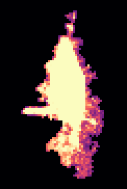<figcaption>#38 · 1227 µm³ · 5 dendrites</figcaption></figure>
<figure class="cell-card" data-glb="../data/sample_1_1/cells/osteocyte_39.glb" data-title="osteocyte 39"><figcaption>#39 · 2964 µm³ · 14 dendrites</figcaption></figure>
<figure class="cell-card" data-glb="../data/sample_1_1/cells/osteocyte_46.glb" data-title="osteocyte 46"><figcaption>#46 · 1270 µm³ · 1 dendrites</figcaption></figure>
<figure class="cell-card" data-glb="../data/sample_1_1/cells/osteocyte_48.glb" data-title="osteocyte 48">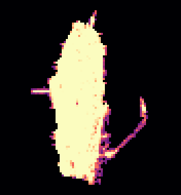<figcaption>#48 · 1499 µm³ · 8 dendrites</figcaption></figure>
<figure class="cell-card" data-glb="../data/sample_1_1/cells/osteocyte_52.glb" data-title="osteocyte 52">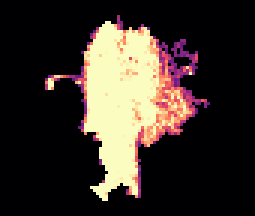<figcaption>#52 · 1153 µm³ · 9 dendrites</figcaption></figure>
<figure class="cell-card" data-glb="../data/sample_1_1/cells/osteocyte_56.glb" data-title="osteocyte 56"><figcaption>#56 · 1060 µm³ · 6 dendrites</figcaption></figure>
<figure class="cell-card" data-glb="../data/sample_1_1/cells/osteocyte_71.glb" data-title="osteocyte 71"><figcaption>#71 · 1934 µm³ · 9 dendrites</figcaption></figure>
<figure class="cell-card" data-glb="../data/sample_1_1/cells/osteocyte_74.glb" data-title="osteocyte 74">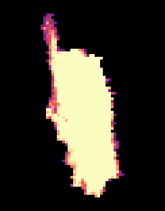<figcaption>#74 · 1201 µm³ · 1 dendrites</figcaption></figure>
<figure class="cell-card" data-glb="../data/sample_1_1/cells/osteocyte_77.glb" data-title="osteocyte 77"><figcaption>#77 · 542 µm³ · 6 dendrites</figcaption></figure>
<figure class="cell-card" data-glb="../data/sample_1_1/cells/osteocyte_78.glb" data-title="osteocyte 78"><figcaption>#78 · 1033 µm³ · 10 dendrites</figcaption></figure>
<figure class="cell-card" data-glb="../data/sample_1_1/cells/osteocyte_79.glb" data-title="osteocyte 79">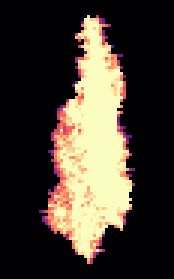<figcaption>#79 · 1594 µm³ · 2 dendrites</figcaption></figure>
<figure class="cell-card" data-glb="../data/sample_1_1/cells/osteocyte_91.glb" data-title="osteocyte 91">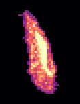<figcaption>#91 · 267 µm³ · 1 dendrites</figcaption></figure>
<figure class="cell-card" data-glb="../data/sample_1_1/cells/osteocyte_94.glb" data-title="osteocyte 94"><figcaption>#94 · 6580 µm³ · 9 dendrites</figcaption></figure>
<figure class="cell-card" data-glb="../data/sample_1_1/cells/osteocyte_95.glb" data-title="osteocyte 95"><figcaption>#95 · 1089 µm³ · 5 dendrites</figcaption></figure>
<figure class="cell-card" data-glb="../data/sample_1_1/cells/osteocyte_96.glb" data-title="osteocyte 96"><figcaption>#96 · 796 µm³ · 7 dendrites</figcaption></figure>
<figure class="cell-card" data-glb="../data/sample_1_1/cells/osteocyte_98.glb" data-title="osteocyte 98"><figcaption>#98 · 599 µm³ · 10 dendrites</figcaption></figure>
<figure class="cell-card" data-glb="../data/sample_1_1/cells/osteocyte_103.glb" data-title="osteocyte 103">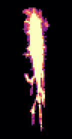<figcaption>#103 · 746 µm³ · 5 dendrites</figcaption></figure>
<figure class="cell-card" data-glb="../data/sample_1_1/cells/osteocyte_106.glb" data-title="osteocyte 106"><figcaption>#106 · 2885 µm³ · 12 dendrites</figcaption></figure>
<figure class="cell-card" data-glb="../data/sample_1_1/cells/osteocyte_117.glb" data-title="osteocyte 117">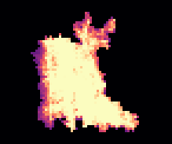<figcaption>#117 · 1801 µm³ · 5 dendrites</figcaption></figure>
<figure class="cell-card" data-glb="../data/sample_1_1/cells/osteocyte_118.glb" data-title="osteocyte 118"><figcaption>#118 · 537 µm³ · 5 dendrites</figcaption></figure>
<figure class="cell-card" data-glb="../data/sample_1_1/cells/osteocyte_121.glb" data-title="osteocyte 121"><figcaption>#121 · 1189 µm³ · 4 dendrites</figcaption></figure>
<figure class="cell-card" data-glb="../data/sample_1_1/cells/osteocyte_122.glb" data-title="osteocyte 122">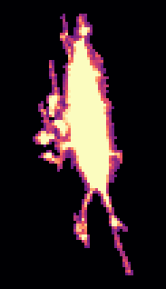<figcaption>#122 · 1681 µm³ · 8 dendrites</figcaption></figure>
<figure class="cell-card" data-glb="../data/sample_1_1/cells/osteocyte_127.glb" data-title="osteocyte 127"><figcaption>#127 · 1499 µm³ · 8 dendrites</figcaption></figure>
<figure class="cell-card" data-glb="../data/sample_1_1/cells/osteocyte_147.glb" data-title="osteocyte 147">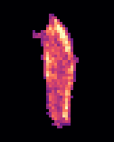<figcaption>#147 · 253 µm³ · 2 dendrites</figcaption></figure>
<figure class="cell-card" data-glb="../data/sample_1_1/cells/osteocyte_154.glb" data-title="osteocyte 154"><figcaption>#154 · 893 µm³ · 5 dendrites</figcaption></figure>
<figure class="cell-card" data-glb="../data/sample_1_1/cells/osteocyte_166.glb" data-title="osteocyte 166">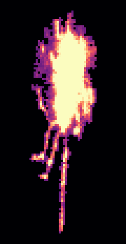<figcaption>#166 · 1626 µm³ · 9 dendrites</figcaption></figure>
<figure class="cell-card" data-glb="../data/sample_1_1/cells/osteocyte_169.glb" data-title="osteocyte 169">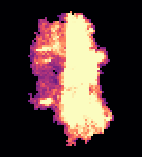<figcaption>#169 · 2177 µm³ · 6 dendrites</figcaption></figure>
<figure class="cell-card" data-glb="../data/sample_1_1/cells/osteocyte_172.glb" data-title="osteocyte 172"><figcaption>#172 · 2327 µm³ · 1 dendrites</figcaption></figure>
<figure class="cell-card" data-glb="../data/sample_1_1/cells/osteocyte_173.glb" data-title="osteocyte 173"><figcaption>#173 · 4768 µm³ · 19 dendrites</figcaption></figure>
<figure class="cell-card" data-glb="../data/sample_1_1/cells/osteocyte_202.glb" data-title="osteocyte 202"><figcaption>#202 · 2503 µm³ · 6 dendrites</figcaption></figure>
<figure class="cell-card" data-glb="../data/sample_1_1/cells/osteocyte_203.glb" data-title="osteocyte 203">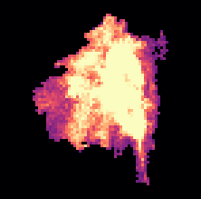<figcaption>#203 · 2135 µm³ · 5 dendrites</figcaption></figure>
<figure class="cell-card" data-glb="../data/sample_1_1/cells/osteocyte_211.glb" data-title="osteocyte 211">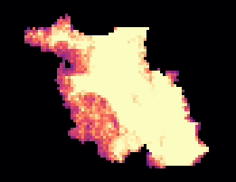<figcaption>#211 · 3186 µm³ · 2 dendrites</figcaption></figure>
<figure class="cell-card" data-glb="../data/sample_1_1/cells/osteocyte_229.glb" data-title="osteocyte 229"><figcaption>#229 · 2123 µm³ · 4 dendrites</figcaption></figure>
<figure class="cell-card" data-glb="../data/sample_1_1/cells/osteocyte_252.glb" data-title="osteocyte 252"><figcaption>#252 · 1094 µm³ · 2 dendrites</figcaption></figure>
</div>
<dialog id="cell-dialog"><form method="dialog"><button class="close" aria-label="close">×</button></form>
<h3 class="cell-title"></h3><model-viewer camera-controls interaction-prompt="none" shadow-intensity="0" class="cell-viewer"></model-viewer></dialog>
```
