<!-- generated by scripts/build_pages.py from data/sample_1_3/; edits are overwritten -->

Voxel size 0.4815 µm (cubic) · volume 53 × 512 × 512 voxels (z, y, x) = 26 × 247 × 247 µm ·
exported 2026-10-07 from `Texas red 20min_24.8.2026.lif`.

Downloads: [osteocyte_props.csv](../data/sample_1_3/osteocyte_props.csv) · [dendrites.csv](../data/sample_1_3/dendrites.csv) · [summary.log](../data/sample_1_3/summary.log) · [summary.json](../data/sample_1_3/summary.json) · [scene.glb](../data/sample_1_3/scene.glb) · [scene_obj.zip](../data/sample_1_3/scene_obj.zip)

## 3D scene

Drag to rotate, scroll to zoom, right-drag to pan. One colour per osteocyte; cleaned ch0 nuclei inside the hull
(bone side) in translucent blue. Depth (z) points up. `scene_obj.zip` has the same scene as OBJ + MTL in µm,
with and without the nuclei.

```{=html}
<button class="btn btn-sm btn-outline-secondary nuclei-toggle" aria-pressed="true" data-target="scene" data-opacity="0.35">Nuclei: shown</button>
<model-viewer id="scene" src="../data/sample_1_3/scene.glb" alt="sample 1.3 osteocytes and nuclei" camera-controls touch-action="pan-y" interaction-prompt="none" shadow-intensity="0" exposure="1.1" class="scene-viewer" camera-orbit="0deg 35deg auto"></model-viewer>
```

## Pipeline counts

| stage | count |
|:--|--:|
| watershed regions | 96 |
| &gt;= 100 voxels and &gt; 5 vox inside xy hull (pass 1) | 55 |
| &gt; 0 vox inside hull without soft tissue (pass 2) | 45 |
| removed: far side of soft tissue | 6 |
| removed: no nucleus | 24 |
| split by nuclei | 2 |
| removed: flat | 1 |
| surviving osteocytes | 16 |
| nuclei (cleaned ch0) | 56 |
| inside hull, bone side | 31 |
| detected | 16 |
| soft tissue | 0 |
| labelled, rejected | 6 |
| no ch1 label | 9 |
| inside hull, not labelled as osteocyte (rejected + no ch1) | 15 |

## Osteocytes

```{=html}
<table class="datatable">
<thead><tr><th>label</th><th>volume (µm³)</th><th>surface (µm²)</th><th>axis 1 (µm)</th><th>axis 2 (µm)</th><th>axis 3 (µm)</th><th>flatness</th><th>nuclei</th><th>nucleus (µm³)</th><th>dendrites</th><th>reach mean (µm)</th><th>reach sd (µm)</th><th>reach max (µm)</th><th>path mean (µm)</th></tr></thead>
<tbody>
<tr><td>6</td><td>133</td><td>217</td><td>10.22</td><td>6.68</td><td>5.93</td><td>0.89</td><td>1</td><td>45.87</td><td>2</td><td>2.45</td><td>0.57</td><td>2.85</td><td>0.34</td></tr>
<tr><td>33</td><td>3479</td><td>3971</td><td>50.04</td><td>20.31</td><td>14.05</td><td>0.69</td><td>1</td><td>64.51</td><td>15</td><td>5.36</td><td>2.31</td><td>9.74</td><td>16.14</td></tr>
<tr><td>35</td><td>929</td><td>1690</td><td>25.25</td><td>20.10</td><td>13.67</td><td>0.68</td><td>1</td><td>32.03</td><td>4</td><td>5.00</td><td>2.47</td><td>7.25</td><td>33.84</td></tr>
<tr><td>39</td><td>385</td><td>570</td><td>32.58</td><td>8.16</td><td>4.79</td><td>0.59</td><td>1</td><td>61.94</td><td>5</td><td>7.30</td><td>8.19</td><td>21.93</td><td>6.07</td></tr>
<tr><td>52</td><td>1452</td><td>2406</td><td>41.47</td><td>19.65</td><td>11.38</td><td>0.58</td><td>1</td><td>44.31</td><td>13</td><td>10.88</td><td>7.21</td><td>23.79</td><td>18.35</td></tr>
<tr><td>60</td><td>198</td><td>308</td><td>10.99</td><td>9.89</td><td>4.93</td><td>0.50</td><td>1</td><td>76.01</td><td>3</td><td>2.81</td><td>0.43</td><td>3.27</td><td>2.13</td></tr>
<tr><td>64</td><td>659</td><td>950</td><td>22.61</td><td>11.26</td><td>9.74</td><td>0.87</td><td>1</td><td>25.11</td><td>5</td><td>4.99</td><td>2.35</td><td>8.13</td><td>13.73</td></tr>
<tr><td>66</td><td>459</td><td>636</td><td>25.26</td><td>8.11</td><td>6.16</td><td>0.76</td><td>1</td><td>84.27</td><td>3</td><td>2.99</td><td>0.79</td><td>3.79</td><td>4.32</td></tr>
<tr><td>70</td><td>917</td><td>2187</td><td>56.09</td><td>16.47</td><td>7.22</td><td>0.44</td><td>1</td><td>68.86</td><td>12</td><td>4.32</td><td>2.60</td><td>10.17</td><td>21.82</td></tr>
<tr><td>73</td><td>1489</td><td>2765</td><td>50.67</td><td>20.52</td><td>13.96</td><td>0.68</td><td>1</td><td>40.07</td><td>11</td><td>9.93</td><td>7.37</td><td>26.80</td><td>32.05</td></tr>
<tr><td>78</td><td>1270</td><td>2432</td><td>41.66</td><td>22.68</td><td>10.16</td><td>0.45</td><td>1</td><td>49.44</td><td>10</td><td>13.35</td><td>7.22</td><td>27.65</td><td>30.39</td></tr>
<tr><td>81</td><td>380</td><td>892</td><td>27.12</td><td>12.51</td><td>5.61</td><td>0.45</td><td>1</td><td>65.18</td><td>3</td><td>5.58</td><td>5.81</td><td>12.28</td><td>37.35</td></tr>
<tr><td>96</td><td>2588</td><td>3240</td><td>44.39</td><td>19.34</td><td>10.06</td><td>0.52</td><td>1</td><td>36.05</td><td>16</td><td>4.00</td><td>3.39</td><td>15.68</td><td>7.87</td></tr>
<tr><td>97</td><td>890</td><td>1445</td><td>32.69</td><td>16.94</td><td>7.29</td><td>0.43</td><td>1</td><td>50.67</td><td>8</td><td>11.31</td><td>4.87</td><td>20.28</td><td>17.03</td></tr>
<tr><td>119</td><td>323</td><td>484</td><td>17.37</td><td>7.69</td><td>6.58</td><td>0.86</td><td>1</td><td>43.98</td><td>2</td><td>2.43</td><td>0.03</td><td>2.46</td><td>7.26</td></tr>
<tr><td>120</td><td>399</td><td>854</td><td>24.66</td><td>13.03</td><td>5.85</td><td>0.45</td><td>1</td><td>43.19</td><td>5</td><td>4.15</td><td>1.39</td><td>5.32</td><td>19.75</td></tr>
</tbody>
</table>
```

## Gallery

Rotating maximum-intensity projections of ch1 inside each osteocyte. Click a cell for its 3D mesh.

```{=html}
<div class="gallery">
<figure class="cell-card" data-glb="../data/sample_1_3/cells/osteocyte_6.glb" data-title="osteocyte 6"><figcaption>#6 · 133 µm³ · 2 dendrites</figcaption></figure>
<figure class="cell-card" data-glb="../data/sample_1_3/cells/osteocyte_33.glb" data-title="osteocyte 33">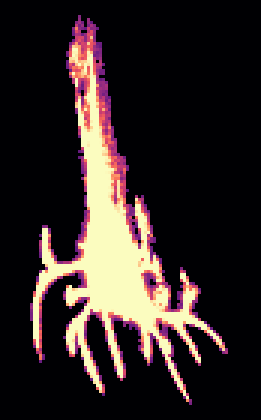<figcaption>#33 · 3479 µm³ · 15 dendrites</figcaption></figure>
<figure class="cell-card" data-glb="../data/sample_1_3/cells/osteocyte_35.glb" data-title="osteocyte 35">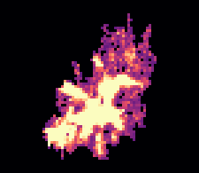<figcaption>#35 · 929 µm³ · 4 dendrites</figcaption></figure>
<figure class="cell-card" data-glb="../data/sample_1_3/cells/osteocyte_39.glb" data-title="osteocyte 39">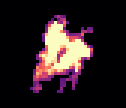<figcaption>#39 · 385 µm³ · 5 dendrites</figcaption></figure>
<figure class="cell-card" data-glb="../data/sample_1_3/cells/osteocyte_52.glb" data-title="osteocyte 52">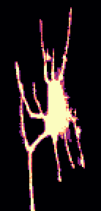<figcaption>#52 · 1452 µm³ · 13 dendrites</figcaption></figure>
<figure class="cell-card" data-glb="../data/sample_1_3/cells/osteocyte_60.glb" data-title="osteocyte 60"><figcaption>#60 · 198 µm³ · 3 dendrites</figcaption></figure>
<figure class="cell-card" data-glb="../data/sample_1_3/cells/osteocyte_64.glb" data-title="osteocyte 64">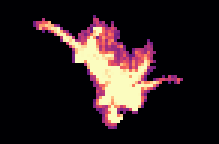<figcaption>#64 · 659 µm³ · 5 dendrites</figcaption></figure>
<figure class="cell-card" data-glb="../data/sample_1_3/cells/osteocyte_66.glb" data-title="osteocyte 66">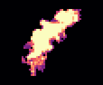<figcaption>#66 · 459 µm³ · 3 dendrites</figcaption></figure>
<figure class="cell-card" data-glb="../data/sample_1_3/cells/osteocyte_70.glb" data-title="osteocyte 70">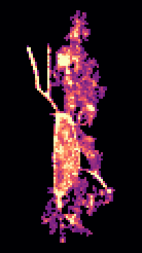<figcaption>#70 · 917 µm³ · 12 dendrites</figcaption></figure>
<figure class="cell-card" data-glb="../data/sample_1_3/cells/osteocyte_73.glb" data-title="osteocyte 73">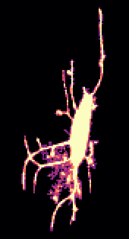<figcaption>#73 · 1489 µm³ · 11 dendrites</figcaption></figure>
<figure class="cell-card" data-glb="../data/sample_1_3/cells/osteocyte_78.glb" data-title="osteocyte 78">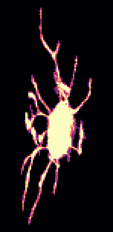<figcaption>#78 · 1270 µm³ · 10 dendrites</figcaption></figure>
<figure class="cell-card" data-glb="../data/sample_1_3/cells/osteocyte_81.glb" data-title="osteocyte 81">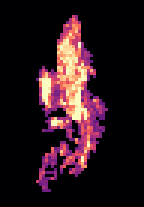<figcaption>#81 · 380 µm³ · 3 dendrites</figcaption></figure>
<figure class="cell-card" data-glb="../data/sample_1_3/cells/osteocyte_96.glb" data-title="osteocyte 96"><figcaption>#96 · 2588 µm³ · 16 dendrites</figcaption></figure>
<figure class="cell-card" data-glb="../data/sample_1_3/cells/osteocyte_97.glb" data-title="osteocyte 97"><figcaption>#97 · 890 µm³ · 8 dendrites</figcaption></figure>
<figure class="cell-card" data-glb="../data/sample_1_3/cells/osteocyte_119.glb" data-title="osteocyte 119">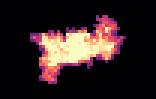<figcaption>#119 · 323 µm³ · 2 dendrites</figcaption></figure>
<figure class="cell-card" data-glb="../data/sample_1_3/cells/osteocyte_120.glb" data-title="osteocyte 120">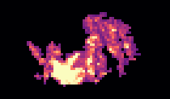<figcaption>#120 · 399 µm³ · 5 dendrites</figcaption></figure>
</div>
<dialog id="cell-dialog"><form method="dialog"><button class="close" aria-label="close">×</button></form>
<h3 class="cell-title"></h3><model-viewer camera-controls interaction-prompt="none" shadow-intensity="0" class="cell-viewer"></model-viewer></dialog>
```
