<!-- generated by scripts/build_pages.py from data/sample_1_3/; edits are overwritten -->

Voxel size 0.4815 µm (cubic) · volume 53 × 512 × 512 voxels (z, y, x) = 26 × 247 × 247 µm ·
exported 2026-10-15 from `Texas red 20min_24.8.2026.lif`.

Downloads: [osteocyte_props.csv](../data/sample_1_3/osteocyte_props.csv) · [dendrites.csv](../data/sample_1_3/dendrites.csv) · [summary.log](../data/sample_1_3/summary.log) · [summary.json](../data/sample_1_3/summary.json) · [scene.glb](../data/sample_1_3/scene.glb) · [scene_obj.zip](../data/sample_1_3/scene_obj.zip)

## 3D scene

Drag to rotate, scroll to zoom, right-drag to pan. One colour per osteocyte; cleaned ch0 nuclei inside the hull
(bone side) in translucent blue. Depth (z) points up. `scene_obj.zip` has the same scene as OBJ + MTL in µm,
with and without the nuclei.

```{=html}
<button class="btn btn-sm btn-outline-secondary nuclei-toggle" aria-pressed="true" data-target="scene" data-opacity="0.35">Nuclei: shown</button>
<model-viewer id="scene" src="../data/sample_1_3/scene.glb" alt="sample 1.3 osteocytes and nuclei" camera-controls touch-action="pan-y" interaction-prompt="none" shadow-intensity="0" exposure="1.1" class="scene-viewer" camera-orbit="0deg 35deg auto"></model-viewer>
```

## Pipeline counts

| stage | count |
|:--|--:|
| watershed regions | 81 |
| &gt;= 100 voxels and &gt; 1 vox inside xy hull (pass 1) | 51 |
| &gt; -3 vox inside hull without soft tissue (pass 2) | 51 |
| removed: far side of soft tissue | 13 |
| removed: no nucleus | 20 |
| split by nuclei | 1 |
| removed: flat | 2 |
| surviving osteocytes | 17 |
| nuclei (cleaned ch0) | 53 |
| inside hull, bone side | 30 |
| detected | 17 |
| soft tissue | 0 |
| labelled, rejected | 3 |
| no ch1 label | 10 |
| inside hull, not labelled as osteocyte (rejected + no ch1) | 13 |
| protrusions reaching &gt;= 2.0 µm | 138 |
| dendrites (rods, counted) | 134 |
| flat parts of the body (sheets, not counted) | 4 |

## Osteocytes

```{=html}
<table class="datatable">
<thead><tr><th>label</th><th>volume (µm³)</th><th>surface (µm²)</th><th>axis 1 (µm)</th><th>axis 2 (µm)</th><th>axis 3 (µm)</th><th>flatness</th><th>nuclei</th><th>nucleus (µm³)</th><th>dendrites</th><th>reach mean (µm)</th><th>reach sd (µm)</th><th>reach max (µm)</th><th>path mean (µm)</th></tr></thead>
<tbody>
<tr><td>6</td><td>499</td><td>665</td><td>15.86</td><td>11.41</td><td>7.86</td><td>0.69</td><td>1</td><td>110</td><td>6</td><td>2.72</td><td>0.56</td><td>3.60</td><td>2.40</td></tr>
<tr><td>20</td><td>499</td><td>930</td><td>28.84</td><td>16.64</td><td>7.15</td><td>0.43</td><td>1</td><td>76.79</td><td>7</td><td>4.98</td><td>3.04</td><td>11.24</td><td>10.43</td></tr>
<tr><td>27</td><td>3750</td><td>4260</td><td>51.24</td><td>20.59</td><td>14.34</td><td>0.70</td><td>1</td><td>65.85</td><td>16</td><td>4.86</td><td>2.39</td><td>9.16</td><td>13.98</td></tr>
<tr><td>29</td><td>1022</td><td>1756</td><td>25.73</td><td>20.50</td><td>13.85</td><td>0.68</td><td>1</td><td>42.08</td><td>5</td><td>4.56</td><td>1.99</td><td>6.44</td><td>24.94</td></tr>
<tr><td>34</td><td>633</td><td>1065</td><td>28.93</td><td>10.54</td><td>9.06</td><td>0.86</td><td>1</td><td>62.61</td><td>11</td><td>5.02</td><td>6.15</td><td>23.30</td><td>6.59</td></tr>
<tr><td>39</td><td>221</td><td>337</td><td>11.25</td><td>10.33</td><td>5.06</td><td>0.49</td><td>1</td><td>85.61</td><td>3</td><td>2.76</td><td>0.45</td><td>3.27</td><td>1.90</td></tr>
<tr><td>42</td><td>1631</td><td>2694</td><td>42.07</td><td>19.94</td><td>12.23</td><td>0.61</td><td>1</td><td>44.31</td><td>11</td><td>11.19</td><td>7.41</td><td>22.65</td><td>20.61</td></tr>
<tr><td>46</td><td>663</td><td>714</td><td>16.63</td><td>12.68</td><td>7.88</td><td>0.62</td><td>1</td><td>166</td><td>3</td><td>3.65</td><td>1.88</td><td>5.82</td><td>3.90</td></tr>
<tr><td>50</td><td>690</td><td>964</td><td>23.21</td><td>11.53</td><td>9.50</td><td>0.82</td><td>1</td><td>28.24</td><td>4</td><td>5.48</td><td>2.27</td><td>8.03</td><td>9.99</td></tr>
<tr><td>55</td><td>723</td><td>1650</td><td>42.87</td><td>15.33</td><td>6.87</td><td>0.45</td><td>1</td><td>71.88</td><td>8</td><td>5.03</td><td>5.32</td><td>17.68</td><td>22.40</td></tr>
<tr><td>58</td><td>1684</td><td>3144</td><td>50.97</td><td>20.87</td><td>14.65</td><td>0.70</td><td>1</td><td>40.07</td><td>12</td><td>8.64</td><td>7.37</td><td>26.80</td><td>34.90</td></tr>
<tr><td>63</td><td>1598</td><td>3111</td><td>44.98</td><td>24.13</td><td>11.27</td><td>0.47</td><td>1</td><td>50.00</td><td>12</td><td>12.12</td><td>8.79</td><td>28.08</td><td>28.88</td></tr>
<tr><td>66</td><td>438</td><td>968</td><td>27.50</td><td>12.80</td><td>5.63</td><td>0.44</td><td>1</td><td>68.64</td><td>2</td><td>5.67</td><td>4.90</td><td>9.14</td><td>58.21</td></tr>
<tr><td>75</td><td>2312</td><td>2201</td><td>42.35</td><td>14.81</td><td>10.45</td><td>0.71</td><td>1</td><td>40.74</td><td>3</td><td>5.95</td><td>4.60</td><td>11.25</td><td>8.46</td></tr>
<tr><td>80</td><td>942</td><td>1627</td><td>24.52</td><td>17.61</td><td>11.63</td><td>0.66</td><td>1</td><td>55.14</td><td>12</td><td>6.54</td><td>5.95</td><td>21.51</td><td>12.40</td></tr>
<tr><td>83</td><td>2812</td><td>3420</td><td>44.77</td><td>19.53</td><td>10.29</td><td>0.53</td><td>1</td><td>36.61</td><td>11</td><td>3.88</td><td>2.29</td><td>9.75</td><td>11.98</td></tr>
<tr><td>84</td><td>961</td><td>1539</td><td>33.21</td><td>17.20</td><td>7.54</td><td>0.44</td><td>1</td><td>51.12</td><td>8</td><td>10.88</td><td>4.58</td><td>18.28</td><td>18.10</td></tr>
</tbody>
</table>
```

## Gallery

Rotating maximum-intensity projections of ch1 inside each osteocyte. Click a cell for its 3D mesh and the
check of its dendrite count: ch1 inside the cell (left) beside the detection (right) as a depth-shaded surface,
rotating, with the cell body grey, counted dendrites blue, flat parts of the body green and short protrusions orange.

```{=html}
<div class="gallery">
<figure class="cell-card" data-glb="../data/sample_1_3/cells/osteocyte_6.glb" data-validation="../data/sample_1_3/cells/osteocyte_6_dendrites" data-title="osteocyte 6: 6 dendrites"><figcaption>#6 · 499 µm³ · 6 dendrites</figcaption></figure>
<figure class="cell-card" data-glb="../data/sample_1_3/cells/osteocyte_20.glb" data-validation="../data/sample_1_3/cells/osteocyte_20_dendrites" data-title="osteocyte 20: 7 dendrites">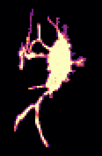<figcaption>#20 · 499 µm³ · 7 dendrites</figcaption></figure>
<figure class="cell-card" data-glb="../data/sample_1_3/cells/osteocyte_27.glb" data-validation="../data/sample_1_3/cells/osteocyte_27_dendrites" data-title="osteocyte 27: 16 dendrites">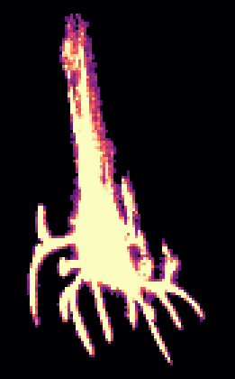<figcaption>#27 · 3750 µm³ · 16 dendrites</figcaption></figure>
<figure class="cell-card" data-glb="../data/sample_1_3/cells/osteocyte_29.glb" data-validation="../data/sample_1_3/cells/osteocyte_29_dendrites" data-title="osteocyte 29: 5 dendrites"><figcaption>#29 · 1022 µm³ · 5 dendrites</figcaption></figure>
<figure class="cell-card" data-glb="../data/sample_1_3/cells/osteocyte_34.glb" data-validation="../data/sample_1_3/cells/osteocyte_34_dendrites" data-title="osteocyte 34: 11 dendrites">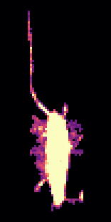<figcaption>#34 · 633 µm³ · 11 dendrites</figcaption></figure>
<figure class="cell-card" data-glb="../data/sample_1_3/cells/osteocyte_39.glb" data-validation="../data/sample_1_3/cells/osteocyte_39_dendrites" data-title="osteocyte 39: 3 dendrites"><figcaption>#39 · 221 µm³ · 3 dendrites</figcaption></figure>
<figure class="cell-card" data-glb="../data/sample_1_3/cells/osteocyte_42.glb" data-validation="../data/sample_1_3/cells/osteocyte_42_dendrites" data-title="osteocyte 42: 11 dendrites">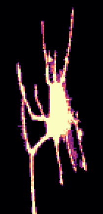<figcaption>#42 · 1631 µm³ · 11 dendrites</figcaption></figure>
<figure class="cell-card" data-glb="../data/sample_1_3/cells/osteocyte_46.glb" data-validation="../data/sample_1_3/cells/osteocyte_46_dendrites" data-title="osteocyte 46: 3 dendrites">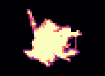<figcaption>#46 · 663 µm³ · 3 dendrites</figcaption></figure>
<figure class="cell-card" data-glb="../data/sample_1_3/cells/osteocyte_50.glb" data-validation="../data/sample_1_3/cells/osteocyte_50_dendrites" data-title="osteocyte 50: 4 dendrites">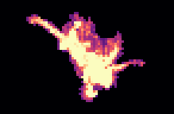<figcaption>#50 · 690 µm³ · 4 dendrites</figcaption></figure>
<figure class="cell-card" data-glb="../data/sample_1_3/cells/osteocyte_55.glb" data-validation="../data/sample_1_3/cells/osteocyte_55_dendrites" data-title="osteocyte 55: 8 dendrites">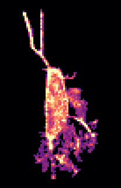<figcaption>#55 · 723 µm³ · 8 dendrites</figcaption></figure>
<figure class="cell-card" data-glb="../data/sample_1_3/cells/osteocyte_58.glb" data-validation="../data/sample_1_3/cells/osteocyte_58_dendrites" data-title="osteocyte 58: 12 dendrites"><figcaption>#58 · 1684 µm³ · 12 dendrites</figcaption></figure>
<figure class="cell-card" data-glb="../data/sample_1_3/cells/osteocyte_63.glb" data-validation="../data/sample_1_3/cells/osteocyte_63_dendrites" data-title="osteocyte 63: 12 dendrites">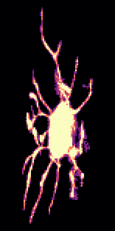<figcaption>#63 · 1598 µm³ · 12 dendrites</figcaption></figure>
<figure class="cell-card" data-glb="../data/sample_1_3/cells/osteocyte_66.glb" data-validation="../data/sample_1_3/cells/osteocyte_66_dendrites" data-title="osteocyte 66: 2 dendrites"><figcaption>#66 · 438 µm³ · 2 dendrites</figcaption></figure>
<figure class="cell-card" data-glb="../data/sample_1_3/cells/osteocyte_75.glb" data-validation="../data/sample_1_3/cells/osteocyte_75_dendrites" data-title="osteocyte 75: 3 dendrites">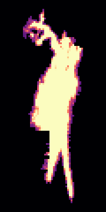<figcaption>#75 · 2312 µm³ · 3 dendrites</figcaption></figure>
<figure class="cell-card" data-glb="../data/sample_1_3/cells/osteocyte_80.glb" data-validation="../data/sample_1_3/cells/osteocyte_80_dendrites" data-title="osteocyte 80: 12 dendrites">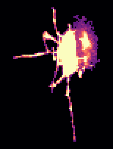<figcaption>#80 · 942 µm³ · 12 dendrites</figcaption></figure>
<figure class="cell-card" data-glb="../data/sample_1_3/cells/osteocyte_83.glb" data-validation="../data/sample_1_3/cells/osteocyte_83_dendrites" data-title="osteocyte 83: 11 dendrites">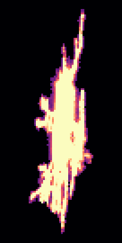<figcaption>#83 · 2812 µm³ · 11 dendrites</figcaption></figure>
<figure class="cell-card" data-glb="../data/sample_1_3/cells/osteocyte_84.glb" data-validation="../data/sample_1_3/cells/osteocyte_84_dendrites" data-title="osteocyte 84: 8 dendrites">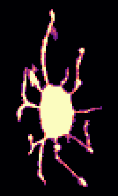<figcaption>#84 · 961 µm³ · 8 dendrites</figcaption></figure>
</div>
<dialog id="cell-dialog"><form method="dialog"><button class="close" aria-label="close">×</button></form>
<h3 class="cell-title"></h3>
<div class="cell-panels">
<model-viewer camera-controls interaction-prompt="none" shadow-intensity="0" class="cell-viewer"></model-viewer>
<figure class="cell-validation">
<figcaption><span class="key" style="--c:#9a9893"></span>body <span class="key" style="--c:#2a78d6"></span>dendrite (counted)
<span class="key" style="--c:#1baf7a"></span>flat part of the body <span class="key" style="--c:#eb6834"></span>short protrusion
· <a class="validation-png" target="_blank">projections (PNG)</a></figcaption></figure>
</div></dialog>
```
