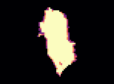
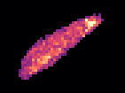
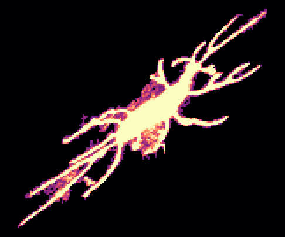
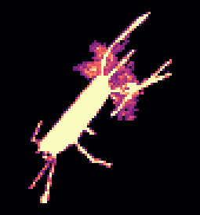
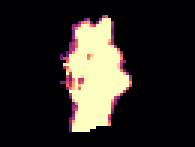
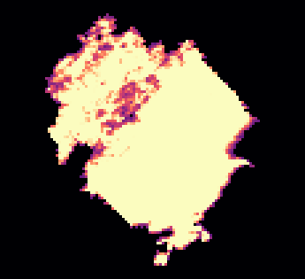
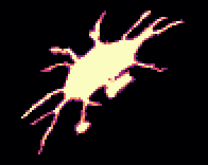
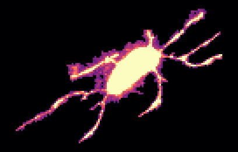
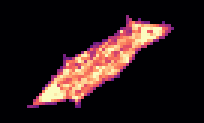
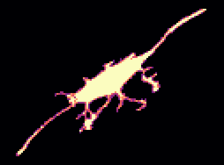

<!-- generated by scripts/build_pages.py from data/sample_1_4/; edits are overwritten -->

Voxel size 0.4815 µm (cubic) · volume 94 × 512 × 512 voxels (z, y, x) = 45 × 247 × 247 µm ·
exported 2026-10-14 from `/Users/ft14968/Projects/osteo-track/lif-files/New_data_sept2026/Texas red 20min_24.8.2026.lif`.

Downloads: [osteocyte_props.csv](../data/sample_1_4/osteocyte_props.csv) · [dendrites.csv](../data/sample_1_4/dendrites.csv) · [summary.log](../data/sample_1_4/summary.log) · [summary.json](../data/sample_1_4/summary.json) · [scene.glb](../data/sample_1_4/scene.glb) · [scene_obj.zip](../data/sample_1_4/scene_obj.zip)

## 3D scene

Drag to rotate, scroll to zoom, right-drag to pan. One colour per osteocyte; cleaned ch0 nuclei inside the hull
(bone side) in translucent blue. Depth (z) points up. `scene_obj.zip` has the same scene as OBJ + MTL in µm,
with and without the nuclei.

```{=html}
<button class="btn btn-sm btn-outline-secondary nuclei-toggle" aria-pressed="true" data-target="scene" data-opacity="0.35">Nuclei: shown</button>
<model-viewer id="scene" src="../data/sample_1_4/scene.glb" alt="sample 1.4 osteocytes and nuclei" camera-controls touch-action="pan-y" interaction-prompt="none" shadow-intensity="0" exposure="1.1" class="scene-viewer" camera-orbit="0deg 35deg auto"></model-viewer>
```

## Pipeline counts

| stage | count |
|:--|--:|
| watershed regions | 160 |
| &gt;= 100 voxels and &gt; 5 vox inside xy hull (pass 1) | 78 |
| &gt; 0 vox inside hull without soft tissue (pass 2) | 66 |
| removed: far side of soft tissue | 4 |
| removed: no nucleus | 17 |
| split by nuclei | 0 |
| removed: flat | 5 |
| surviving osteocytes | 40 |
| nuclei (cleaned ch0) | 114 |
| inside hull, bone side | 80 |
| detected | 39 |
| soft tissue | 13 |
| labelled, rejected | 13 |
| no ch1 label | 15 |
| inside hull, not labelled as osteocyte (rejected + no ch1) | 28 |
| protrusions reaching &gt;= 2.0 µm | 336 |
| dendrites (rods, counted) | 334 |
| flat parts of the body (sheets, not counted) | 2 |

## Osteocytes

```{=html}
<table class="datatable">
<thead><tr><th>label</th><th>volume (µm³)</th><th>surface (µm²)</th><th>axis 1 (µm)</th><th>axis 2 (µm)</th><th>axis 3 (µm)</th><th>flatness</th><th>nuclei</th><th>nucleus (µm³)</th><th>dendrites</th><th>reach mean (µm)</th><th>reach sd (µm)</th><th>reach max (µm)</th><th>path mean (µm)</th></tr></thead>
<tbody>
<tr><td>9</td><td>55.81</td><td>118</td><td>8.28</td><td>6.34</td><td>2.72</td><td>0.43</td><td>1</td><td>30.36</td><td>0</td><td></td><td></td><td></td><td></td></tr>
<tr><td>24</td><td>3132</td><td>3636</td><td>45.19</td><td>20.05</td><td>12.20</td><td>0.61</td><td>1</td><td>61.72</td><td>11</td><td>5.58</td><td>6.55</td><td>24.53</td><td>15.62</td></tr>
<tr><td>27</td><td>1731</td><td>2414</td><td>41.41</td><td>22.65</td><td>9.70</td><td>0.43</td><td>1</td><td>64.29</td><td>14</td><td>7.01</td><td>5.12</td><td>19.62</td><td>11.01</td></tr>
<tr><td>36</td><td>3043</td><td>2783</td><td>37.04</td><td>16.34</td><td>13.55</td><td>0.83</td><td>1</td><td>180</td><td>11</td><td>4.20</td><td>2.03</td><td>7.82</td><td>6.82</td></tr>
<tr><td>37</td><td>1520</td><td>2043</td><td>37.35</td><td>12.84</td><td>12.07</td><td>0.94</td><td>1</td><td>49.78</td><td>9</td><td>6.45</td><td>3.63</td><td>13.46</td><td>12.72</td></tr>
<tr><td>38</td><td>1442</td><td>1250</td><td>28.89</td><td>16.87</td><td>7.89</td><td>0.47</td><td>1</td><td>43.86</td><td>2</td><td>2.04</td><td>0</td><td>2.04</td><td>0.58</td></tr>
<tr><td>43</td><td>142</td><td>263</td><td>20.00</td><td>4.83</td><td>3.25</td><td>0.67</td><td>1</td><td>38.84</td><td>0</td><td></td><td></td><td></td><td></td></tr>
<tr><td>44</td><td>3102</td><td>4454</td><td>65.43</td><td>17.87</td><td>11.68</td><td>0.65</td><td>1</td><td>49.78</td><td>22</td><td>6.02</td><td>4.44</td><td>20.95</td><td>14.60</td></tr>
<tr><td>47</td><td>2061</td><td>2852</td><td>59.93</td><td>12.80</td><td>10.15</td><td>0.79</td><td>1</td><td>61.83</td><td>13</td><td>3.13</td><td>2.04</td><td>8.63</td><td>9.36</td></tr>
<tr><td>52</td><td>1964</td><td>2393</td><td>45.70</td><td>13.12</td><td>10.09</td><td>0.77</td><td>1</td><td>48.77</td><td>8</td><td>3.89</td><td>1.68</td><td>7.58</td><td>14.49</td></tr>
<tr><td>55</td><td>782</td><td>1463</td><td>38.26</td><td>16.62</td><td>8.14</td><td>0.49</td><td>1</td><td>61.50</td><td>10</td><td>6.74</td><td>3.90</td><td>12.96</td><td>12.92</td></tr>
<tr><td>57</td><td>1070</td><td>1055</td><td>21.63</td><td>14.01</td><td>9.09</td><td>0.65</td><td>1</td><td>52.90</td><td>3</td><td>2.30</td><td>0.23</td><td>2.46</td><td>2.49</td></tr>
<tr><td>60</td><td>2491</td><td>4043</td><td>71.37</td><td>18.82</td><td>12.14</td><td>0.65</td><td>1</td><td>30.36</td><td>14</td><td>4.84</td><td>4.34</td><td>15.72</td><td>25.79</td></tr>
<tr><td>62</td><td>1301</td><td>2088</td><td>49.25</td><td>17.69</td><td>8.55</td><td>0.48</td><td>1</td><td>50.45</td><td>10</td><td>10.26</td><td>9.33</td><td>35.02</td><td>21.09</td></tr>
<tr><td>65</td><td>682</td><td>1487</td><td>49.24</td><td>17.23</td><td>7.95</td><td>0.46</td><td>1</td><td>53.02</td><td>9</td><td>7.29</td><td>3.33</td><td>11.09</td><td>19.07</td></tr>
<tr><td>71</td><td>1258</td><td>1532</td><td>27.30</td><td>14.35</td><td>9.15</td><td>0.64</td><td>1</td><td>40.52</td><td>6</td><td>6.14</td><td>6.76</td><td>19.85</td><td>11.22</td></tr>
<tr><td>76</td><td>6880</td><td>5988</td><td>41.79</td><td>31.25</td><td>26.51</td><td>0.85</td><td>1</td><td>221</td><td>9</td><td>2.98</td><td>0.94</td><td>4.64</td><td>5.66</td></tr>
<tr><td>82</td><td>5244</td><td>5402</td><td>41.78</td><td>24.29</td><td>17.18</td><td>0.71</td><td>1</td><td>34.26</td><td>21</td><td>3.96</td><td>2.15</td><td>9.98</td><td>7.07</td></tr>
<tr><td>84</td><td>415</td><td>585</td><td>22.37</td><td>8.25</td><td>6.40</td><td>0.78</td><td>1</td><td>53.57</td><td>6</td><td>4.11</td><td>1.59</td><td>6.89</td><td>3.04</td></tr>
<tr><td>91</td><td>379</td><td>565</td><td>17.89</td><td>9.71</td><td>5.36</td><td>0.55</td><td>1</td><td>52.57</td><td>4</td><td>3.27</td><td>1.00</td><td>4.67</td><td>4.21</td></tr>
<tr><td>95</td><td>1054</td><td>1448</td><td>31.93</td><td>15.33</td><td>8.85</td><td>0.58</td><td>1</td><td>46.99</td><td>13</td><td>5.95</td><td>2.77</td><td>10.99</td><td>6.06</td></tr>
<tr><td>99</td><td>2452</td><td>3020</td><td>45.16</td><td>14.49</td><td>13.17</td><td>0.91</td><td>1</td><td>39.85</td><td>12</td><td>3.32</td><td>1.16</td><td>5.96</td><td>9.94</td></tr>
<tr><td>108</td><td>1819</td><td>2894</td><td>40.54</td><td>18.04</td><td>10.14</td><td>0.56</td><td>1</td><td>47.99</td><td>11</td><td>8.62</td><td>7.33</td><td>21.45</td><td>25.60</td></tr>
<tr><td>122</td><td>328</td><td>511</td><td>27.69</td><td>7.43</td><td>3.72</td><td>0.50</td><td>1</td><td>50.78</td><td>2</td><td>2.33</td><td>0.18</td><td>2.46</td><td>1.58</td></tr>
<tr><td>123</td><td>2710</td><td>3427</td><td>52.78</td><td>17.15</td><td>9.48</td><td>0.55</td><td>1</td><td>54.69</td><td>10</td><td>4.09</td><td>2.85</td><td>11.33</td><td>19.67</td></tr>
<tr><td>125</td><td>515</td><td>843</td><td>31.56</td><td>10.11</td><td>5.66</td><td>0.56</td><td>1</td><td>32.48</td><td>10</td><td>5.47</td><td>4.93</td><td>18.78</td><td>5.18</td></tr>
<tr><td>128</td><td>362</td><td>530</td><td>19.99</td><td>7.70</td><td>7.31</td><td>0.95</td><td>1</td><td>50.78</td><td>4</td><td>4.05</td><td>0.58</td><td>4.79</td><td>7.13</td></tr>
<tr><td>131</td><td>196</td><td>312</td><td>18.95</td><td>7.15</td><td>3.52</td><td>0.49</td><td>1</td><td>41.74</td><td>1</td><td>2.77</td><td></td><td>2.77</td><td>0.68</td></tr>
<tr><td>134</td><td>189</td><td>320</td><td>22.08</td><td>6.15</td><td>3.03</td><td>0.49</td><td>1</td><td>34.82</td><td>2</td><td>2.12</td><td>0.12</td><td>2.21</td><td>1.16</td></tr>
<tr><td>136</td><td>349</td><td>579</td><td>25.20</td><td>7.84</td><td>4.62</td><td>0.59</td><td>1</td><td>39.06</td><td>4</td><td>3.83</td><td>0.34</td><td>4.22</td><td>5.58</td></tr>
<tr><td>144</td><td>205</td><td>356</td><td>26.87</td><td>5.70</td><td>2.88</td><td>0.51</td><td>1</td><td>43.42</td><td>2</td><td>3.11</td><td>0.55</td><td>3.51</td><td>2.99</td></tr>
<tr><td>157</td><td>1695</td><td>2198</td><td>33.26</td><td>17.94</td><td>9.92</td><td>0.55</td><td>1</td><td>34.04</td><td>9</td><td>10.30</td><td>3.02</td><td>14.20</td><td>14.09</td></tr>
<tr><td>160</td><td>849</td><td>1407</td><td>45.19</td><td>13.42</td><td>8.45</td><td>0.63</td><td>1</td><td>43.64</td><td>9</td><td>9.38</td><td>7.65</td><td>23.13</td><td>13.15</td></tr>
<tr><td>163</td><td>1463</td><td>1891</td><td>30.82</td><td>19.21</td><td>8.24</td><td>0.43</td><td>1</td><td>36.39</td><td>13</td><td>3.56</td><td>2.34</td><td>10.56</td><td>5.84</td></tr>
<tr><td>170</td><td>2538</td><td>2971</td><td>43.79</td><td>18.02</td><td>10.73</td><td>0.60</td><td>1</td><td>42.30</td><td>10</td><td>3.17</td><td>1.33</td><td>5.88</td><td>8.36</td></tr>
<tr><td>173</td><td>1913</td><td>2173</td><td>34.19</td><td>18.89</td><td>11.11</td><td>0.59</td><td>1</td><td>41.07</td><td>7</td><td>3.79</td><td>3.69</td><td>12.11</td><td>15.63</td></tr>
<tr><td>184</td><td>431</td><td>574</td><td>27.28</td><td>9.07</td><td>3.98</td><td>0.44</td><td>1</td><td>37.84</td><td>3</td><td>2.65</td><td>0.38</td><td>2.89</td><td>2.01</td></tr>
<tr><td>218</td><td>2009</td><td>2774</td><td>60.84</td><td>14.40</td><td>7.83</td><td>0.54</td><td>1</td><td>26.56</td><td>14</td><td>3.42</td><td>2.11</td><td>9.82</td><td>8.66</td></tr>
<tr><td>234</td><td>826</td><td>1150</td><td>39.63</td><td>9.72</td><td>6.66</td><td>0.69</td><td>1</td><td>38.95</td><td>5</td><td>3.09</td><td>0.88</td><td>4.46</td><td>7.09</td></tr>
<tr><td>244</td><td>1954</td><td>2459</td><td>35.51</td><td>27.05</td><td>11.22</td><td>0.41</td><td>1</td><td>29.35</td><td>11</td><td>2.66</td><td>0.68</td><td>4.57</td><td>5.37</td></tr>
</tbody>
</table>
```

## Gallery

Rotating maximum-intensity projections of ch1 inside each osteocyte. Click a cell for its 3D mesh and the
check of its dendrite count: ch1 inside the cell (left) beside the detection (right) as a depth-shaded surface,
rotating, with the cell body grey, counted dendrites blue, flat parts of the body green and short protrusions orange.

```{=html}
<div class="gallery">
<figure class="cell-card" data-glb="../data/sample_1_4/cells/osteocyte_9.glb" data-validation="../data/sample_1_4/cells/osteocyte_9_dendrites" data-title="osteocyte 9: 0 dendrites"><figcaption>#9 · 55.81 µm³ · 0 dendrites</figcaption></figure>
<figure class="cell-card" data-glb="../data/sample_1_4/cells/osteocyte_24.glb" data-validation="../data/sample_1_4/cells/osteocyte_24_dendrites" data-title="osteocyte 24: 11 dendrites"><figcaption>#24 · 3132 µm³ · 11 dendrites</figcaption></figure>
<figure class="cell-card" data-glb="../data/sample_1_4/cells/osteocyte_27.glb" data-validation="../data/sample_1_4/cells/osteocyte_27_dendrites" data-title="osteocyte 27: 14 dendrites"><figcaption>#27 · 1731 µm³ · 14 dendrites</figcaption></figure>
<figure class="cell-card" data-glb="../data/sample_1_4/cells/osteocyte_36.glb" data-validation="../data/sample_1_4/cells/osteocyte_36_dendrites" data-title="osteocyte 36: 11 dendrites"><figcaption>#36 · 3043 µm³ · 11 dendrites</figcaption></figure>
<figure class="cell-card" data-glb="../data/sample_1_4/cells/osteocyte_37.glb" data-validation="../data/sample_1_4/cells/osteocyte_37_dendrites" data-title="osteocyte 37: 9 dendrites"><figcaption>#37 · 1520 µm³ · 9 dendrites</figcaption></figure>
<figure class="cell-card" data-glb="../data/sample_1_4/cells/osteocyte_38.glb" data-validation="../data/sample_1_4/cells/osteocyte_38_dendrites" data-title="osteocyte 38: 2 dendrites"><figcaption>#38 · 1442 µm³ · 2 dendrites</figcaption></figure>
<figure class="cell-card" data-glb="../data/sample_1_4/cells/osteocyte_43.glb" data-validation="../data/sample_1_4/cells/osteocyte_43_dendrites" data-title="osteocyte 43: 0 dendrites"><figcaption>#43 · 142 µm³ · 0 dendrites</figcaption></figure>
<figure class="cell-card" data-glb="../data/sample_1_4/cells/osteocyte_44.glb" data-validation="../data/sample_1_4/cells/osteocyte_44_dendrites" data-title="osteocyte 44: 22 dendrites"><figcaption>#44 · 3102 µm³ · 22 dendrites</figcaption></figure>
<figure class="cell-card" data-glb="../data/sample_1_4/cells/osteocyte_47.glb" data-validation="../data/sample_1_4/cells/osteocyte_47_dendrites" data-title="osteocyte 47: 13 dendrites"><figcaption>#47 · 2061 µm³ · 13 dendrites</figcaption></figure>
<figure class="cell-card" data-glb="../data/sample_1_4/cells/osteocyte_52.glb" data-validation="../data/sample_1_4/cells/osteocyte_52_dendrites" data-title="osteocyte 52: 8 dendrites"><figcaption>#52 · 1964 µm³ · 8 dendrites</figcaption></figure>
<figure class="cell-card" data-glb="../data/sample_1_4/cells/osteocyte_55.glb" data-validation="../data/sample_1_4/cells/osteocyte_55_dendrites" data-title="osteocyte 55: 10 dendrites"><figcaption>#55 · 782 µm³ · 10 dendrites</figcaption></figure>
<figure class="cell-card" data-glb="../data/sample_1_4/cells/osteocyte_57.glb" data-validation="../data/sample_1_4/cells/osteocyte_57_dendrites" data-title="osteocyte 57: 3 dendrites"><figcaption>#57 · 1070 µm³ · 3 dendrites</figcaption></figure>
<figure class="cell-card" data-glb="../data/sample_1_4/cells/osteocyte_60.glb" data-validation="../data/sample_1_4/cells/osteocyte_60_dendrites" data-title="osteocyte 60: 14 dendrites"><figcaption>#60 · 2491 µm³ · 14 dendrites</figcaption></figure>
<figure class="cell-card" data-glb="../data/sample_1_4/cells/osteocyte_62.glb" data-validation="../data/sample_1_4/cells/osteocyte_62_dendrites" data-title="osteocyte 62: 10 dendrites"><figcaption>#62 · 1301 µm³ · 10 dendrites</figcaption></figure>
<figure class="cell-card" data-glb="../data/sample_1_4/cells/osteocyte_65.glb" data-validation="../data/sample_1_4/cells/osteocyte_65_dendrites" data-title="osteocyte 65: 9 dendrites"><figcaption>#65 · 682 µm³ · 9 dendrites</figcaption></figure>
<figure class="cell-card" data-glb="../data/sample_1_4/cells/osteocyte_71.glb" data-validation="../data/sample_1_4/cells/osteocyte_71_dendrites" data-title="osteocyte 71: 6 dendrites"><figcaption>#71 · 1258 µm³ · 6 dendrites</figcaption></figure>
<figure class="cell-card" data-glb="../data/sample_1_4/cells/osteocyte_76.glb" data-validation="../data/sample_1_4/cells/osteocyte_76_dendrites" data-title="osteocyte 76: 9 dendrites"><figcaption>#76 · 6880 µm³ · 9 dendrites</figcaption></figure>
<figure class="cell-card" data-glb="../data/sample_1_4/cells/osteocyte_82.glb" data-validation="../data/sample_1_4/cells/osteocyte_82_dendrites" data-title="osteocyte 82: 21 dendrites"><figcaption>#82 · 5244 µm³ · 21 dendrites</figcaption></figure>
<figure class="cell-card" data-glb="../data/sample_1_4/cells/osteocyte_84.glb" data-validation="../data/sample_1_4/cells/osteocyte_84_dendrites" data-title="osteocyte 84: 6 dendrites"><figcaption>#84 · 415 µm³ · 6 dendrites</figcaption></figure>
<figure class="cell-card" data-glb="../data/sample_1_4/cells/osteocyte_91.glb" data-validation="../data/sample_1_4/cells/osteocyte_91_dendrites" data-title="osteocyte 91: 4 dendrites"><figcaption>#91 · 379 µm³ · 4 dendrites</figcaption></figure>
<figure class="cell-card" data-glb="../data/sample_1_4/cells/osteocyte_95.glb" data-validation="../data/sample_1_4/cells/osteocyte_95_dendrites" data-title="osteocyte 95: 13 dendrites"><figcaption>#95 · 1054 µm³ · 13 dendrites</figcaption></figure>
<figure class="cell-card" data-glb="../data/sample_1_4/cells/osteocyte_99.glb" data-validation="../data/sample_1_4/cells/osteocyte_99_dendrites" data-title="osteocyte 99: 12 dendrites"><figcaption>#99 · 2452 µm³ · 12 dendrites</figcaption></figure>
<figure class="cell-card" data-glb="../data/sample_1_4/cells/osteocyte_108.glb" data-validation="../data/sample_1_4/cells/osteocyte_108_dendrites" data-title="osteocyte 108: 11 dendrites"><figcaption>#108 · 1819 µm³ · 11 dendrites</figcaption></figure>
<figure class="cell-card" data-glb="../data/sample_1_4/cells/osteocyte_122.glb" data-validation="../data/sample_1_4/cells/osteocyte_122_dendrites" data-title="osteocyte 122: 2 dendrites"><figcaption>#122 · 328 µm³ · 2 dendrites</figcaption></figure>
<figure class="cell-card" data-glb="../data/sample_1_4/cells/osteocyte_123.glb" data-validation="../data/sample_1_4/cells/osteocyte_123_dendrites" data-title="osteocyte 123: 10 dendrites"><figcaption>#123 · 2710 µm³ · 10 dendrites</figcaption></figure>
<figure class="cell-card" data-glb="../data/sample_1_4/cells/osteocyte_125.glb" data-validation="../data/sample_1_4/cells/osteocyte_125_dendrites" data-title="osteocyte 125: 10 dendrites"><figcaption>#125 · 515 µm³ · 10 dendrites</figcaption></figure>
<figure class="cell-card" data-glb="../data/sample_1_4/cells/osteocyte_128.glb" data-validation="../data/sample_1_4/cells/osteocyte_128_dendrites" data-title="osteocyte 128: 4 dendrites"><figcaption>#128 · 362 µm³ · 4 dendrites</figcaption></figure>
<figure class="cell-card" data-glb="../data/sample_1_4/cells/osteocyte_131.glb" data-validation="../data/sample_1_4/cells/osteocyte_131_dendrites" data-title="osteocyte 131: 1 dendrites"><figcaption>#131 · 196 µm³ · 1 dendrites</figcaption></figure>
<figure class="cell-card" data-glb="../data/sample_1_4/cells/osteocyte_134.glb" data-validation="../data/sample_1_4/cells/osteocyte_134_dendrites" data-title="osteocyte 134: 2 dendrites"><figcaption>#134 · 189 µm³ · 2 dendrites</figcaption></figure>
<figure class="cell-card" data-glb="../data/sample_1_4/cells/osteocyte_136.glb" data-validation="../data/sample_1_4/cells/osteocyte_136_dendrites" data-title="osteocyte 136: 4 dendrites"><figcaption>#136 · 349 µm³ · 4 dendrites</figcaption></figure>
<figure class="cell-card" data-glb="../data/sample_1_4/cells/osteocyte_144.glb" data-validation="../data/sample_1_4/cells/osteocyte_144_dendrites" data-title="osteocyte 144: 2 dendrites"><figcaption>#144 · 205 µm³ · 2 dendrites</figcaption></figure>
<figure class="cell-card" data-glb="../data/sample_1_4/cells/osteocyte_157.glb" data-validation="../data/sample_1_4/cells/osteocyte_157_dendrites" data-title="osteocyte 157: 9 dendrites"><figcaption>#157 · 1695 µm³ · 9 dendrites</figcaption></figure>
<figure class="cell-card" data-glb="../data/sample_1_4/cells/osteocyte_160.glb" data-validation="../data/sample_1_4/cells/osteocyte_160_dendrites" data-title="osteocyte 160: 9 dendrites"><figcaption>#160 · 849 µm³ · 9 dendrites</figcaption></figure>
<figure class="cell-card" data-glb="../data/sample_1_4/cells/osteocyte_163.glb" data-validation="../data/sample_1_4/cells/osteocyte_163_dendrites" data-title="osteocyte 163: 13 dendrites"><figcaption>#163 · 1463 µm³ · 13 dendrites</figcaption></figure>
<figure class="cell-card" data-glb="../data/sample_1_4/cells/osteocyte_170.glb" data-validation="../data/sample_1_4/cells/osteocyte_170_dendrites" data-title="osteocyte 170: 10 dendrites"><figcaption>#170 · 2538 µm³ · 10 dendrites</figcaption></figure>
<figure class="cell-card" data-glb="../data/sample_1_4/cells/osteocyte_173.glb" data-validation="../data/sample_1_4/cells/osteocyte_173_dendrites" data-title="osteocyte 173: 7 dendrites"><figcaption>#173 · 1913 µm³ · 7 dendrites</figcaption></figure>
<figure class="cell-card" data-glb="../data/sample_1_4/cells/osteocyte_184.glb" data-validation="../data/sample_1_4/cells/osteocyte_184_dendrites" data-title="osteocyte 184: 3 dendrites"><figcaption>#184 · 431 µm³ · 3 dendrites</figcaption></figure>
<figure class="cell-card" data-glb="../data/sample_1_4/cells/osteocyte_218.glb" data-validation="../data/sample_1_4/cells/osteocyte_218_dendrites" data-title="osteocyte 218: 14 dendrites"><figcaption>#218 · 2009 µm³ · 14 dendrites</figcaption></figure>
<figure class="cell-card" data-glb="../data/sample_1_4/cells/osteocyte_234.glb" data-validation="../data/sample_1_4/cells/osteocyte_234_dendrites" data-title="osteocyte 234: 5 dendrites"><figcaption>#234 · 826 µm³ · 5 dendrites</figcaption></figure>
<figure class="cell-card" data-glb="../data/sample_1_4/cells/osteocyte_244.glb" data-validation="../data/sample_1_4/cells/osteocyte_244_dendrites" data-title="osteocyte 244: 11 dendrites"><figcaption>#244 · 1954 µm³ · 11 dendrites</figcaption></figure>
</div>
<dialog id="cell-dialog"><form method="dialog"><button class="close" aria-label="close">×</button></form>
<h3 class="cell-title"></h3>
<div class="cell-panels">
<model-viewer camera-controls interaction-prompt="none" shadow-intensity="0" class="cell-viewer"></model-viewer>
<figure class="cell-validation">
<figcaption><span class="key" style="--c:#9a9893"></span>body <span class="key" style="--c:#2a78d6"></span>dendrite (counted)
<span class="key" style="--c:#1baf7a"></span>flat part of the body <span class="key" style="--c:#eb6834"></span>short protrusion
· <a class="validation-png" target="_blank">projections (PNG)</a></figcaption></figure>
</div></dialog>
```
