<!-- generated by scripts/build_pages.py from data/sample_2_1_ultrasonic_cleaned/; edits are overwritten -->

Voxel size 0.4815 µm (cubic) · volume 61 × 512 × 512 voxels (z, y, x) = 29 × 247 × 247 µm ·
exported 2026-10-14 from `/Users/ft14968/Projects/osteo-track/lif-files/New_data_sept2026/Texas red 20min_24.8.2026.lif`.

Downloads: [osteocyte_props.csv](../data/sample_2_1_ultrasonic_cleaned/osteocyte_props.csv) · [dendrites.csv](../data/sample_2_1_ultrasonic_cleaned/dendrites.csv) · [summary.log](../data/sample_2_1_ultrasonic_cleaned/summary.log) · [summary.json](../data/sample_2_1_ultrasonic_cleaned/summary.json) · [scene.glb](../data/sample_2_1_ultrasonic_cleaned/scene.glb) · [scene_obj.zip](../data/sample_2_1_ultrasonic_cleaned/scene_obj.zip)

## 3D scene

Drag to rotate, scroll to zoom, right-drag to pan. One colour per osteocyte; cleaned ch0 nuclei inside the hull
(bone side) in translucent blue. Depth (z) points up. `scene_obj.zip` has the same scene as OBJ + MTL in µm,
with and without the nuclei.

```{=html}
<button class="btn btn-sm btn-outline-secondary nuclei-toggle" aria-pressed="true" data-target="scene" data-opacity="0.35">Nuclei: shown</button>
<model-viewer id="scene" src="../data/sample_2_1_ultrasonic_cleaned/scene.glb" alt="sample 2.1_ultrasonic cleaned osteocytes and nuclei" camera-controls touch-action="pan-y" interaction-prompt="none" shadow-intensity="0" exposure="1.1" class="scene-viewer" camera-orbit="0deg 35deg auto"></model-viewer>
```

## Pipeline counts

| stage | count |
|:--|--:|
| watershed regions | 116 |
| &gt;= 100 voxels and &gt; 5 vox inside xy hull (pass 1) | 59 |
| &gt; 0 vox inside hull without soft tissue (pass 2) | 48 |
| removed: far side of soft tissue | 3 |
| removed: no nucleus | 22 |
| split by nuclei | 0 |
| removed: flat | 2 |
| surviving osteocytes | 21 |
| nuclei (cleaned ch0) | 46 |
| inside hull, bone side | 35 |
| detected | 21 |
| soft tissue | 3 |
| labelled, rejected | 5 |
| no ch1 label | 6 |
| inside hull, not labelled as osteocyte (rejected + no ch1) | 11 |
| protrusions reaching &gt;= 2.0 µm | 151 |
| dendrites (rods, counted) | 150 |
| flat parts of the body (sheets, not counted) | 1 |

## Osteocytes

```{=html}
<table class="datatable">
<thead><tr><th>label</th><th>volume (µm³)</th><th>surface (µm²)</th><th>axis 1 (µm)</th><th>axis 2 (µm)</th><th>axis 3 (µm)</th><th>flatness</th><th>nuclei</th><th>nucleus (µm³)</th><th>dendrites</th><th>reach mean (µm)</th><th>reach sd (µm)</th><th>reach max (µm)</th><th>path mean (µm)</th></tr></thead>
<tbody>
<tr><td>18</td><td>975</td><td>1903</td><td>44.21</td><td>16.57</td><td>6.72</td><td>0.41</td><td>1</td><td>46.32</td><td>12</td><td>5.87</td><td>3.89</td><td>12.78</td><td>18.37</td></tr>
<tr><td>21</td><td>740</td><td>1435</td><td>43.40</td><td>11.43</td><td>6.72</td><td>0.59</td><td>1</td><td>50.23</td><td>7</td><td>5.74</td><td>4.03</td><td>13.86</td><td>28.25</td></tr>
<tr><td>23</td><td>1051</td><td>1882</td><td>41.12</td><td>16.61</td><td>7.41</td><td>0.45</td><td>1</td><td>35.16</td><td>6</td><td>7.78</td><td>5.54</td><td>13.59</td><td>32.95</td></tr>
<tr><td>26</td><td>645</td><td>927</td><td>35.59</td><td>9.06</td><td>6.31</td><td>0.70</td><td>1</td><td>40.29</td><td>7</td><td>4.51</td><td>4.72</td><td>15.17</td><td>3.61</td></tr>
<tr><td>37</td><td>820</td><td>1249</td><td>39.52</td><td>10.29</td><td>8.01</td><td>0.78</td><td>1</td><td>34.26</td><td>7</td><td>10.39</td><td>6.36</td><td>19.94</td><td>14.72</td></tr>
<tr><td>38</td><td>611</td><td>763</td><td>27.12</td><td>8.79</td><td>7.17</td><td>0.82</td><td>1</td><td>34.60</td><td>6</td><td>6.62</td><td>6.36</td><td>18.23</td><td>6.27</td></tr>
<tr><td>39</td><td>560</td><td>889</td><td>34.25</td><td>11.05</td><td>6.63</td><td>0.60</td><td>1</td><td>36.61</td><td>9</td><td>4.94</td><td>3.79</td><td>12.08</td><td>7.39</td></tr>
<tr><td>47</td><td>472</td><td>584</td><td>23.38</td><td>8.91</td><td>5.58</td><td>0.63</td><td>1</td><td>30.02</td><td>3</td><td>3.48</td><td>0.79</td><td>4.39</td><td>1.70</td></tr>
<tr><td>55</td><td>758</td><td>1010</td><td>26.85</td><td>12.52</td><td>6.61</td><td>0.53</td><td>1</td><td>55.36</td><td>10</td><td>6.22</td><td>3.89</td><td>15.25</td><td>5.66</td></tr>
<tr><td>61</td><td>1432</td><td>2155</td><td>58.83</td><td>11.12</td><td>9.55</td><td>0.86</td><td>1</td><td>25.89</td><td>7</td><td>11.69</td><td>10.12</td><td>30.54</td><td>25.36</td></tr>
<tr><td>74</td><td>862</td><td>1532</td><td>39.55</td><td>16.20</td><td>7.38</td><td>0.46</td><td>1</td><td>26.23</td><td>7</td><td>4.18</td><td>3.84</td><td>12.50</td><td>23.21</td></tr>
<tr><td>77</td><td>694</td><td>1067</td><td>35.74</td><td>9.38</td><td>6.70</td><td>0.71</td><td>1</td><td>41.85</td><td>9</td><td>5.49</td><td>3.49</td><td>10.86</td><td>8.37</td></tr>
<tr><td>82</td><td>898</td><td>1311</td><td>52.60</td><td>8.52</td><td>5.85</td><td>0.69</td><td>1</td><td>25.45</td><td>5</td><td>6.04</td><td>5.95</td><td>16.44</td><td>15.29</td></tr>
<tr><td>87</td><td>2613</td><td>2837</td><td>43.98</td><td>16.86</td><td>9.41</td><td>0.56</td><td>1</td><td>33.04</td><td>11</td><td>4.38</td><td>4.72</td><td>18.28</td><td>7.90</td></tr>
<tr><td>117</td><td>1538</td><td>2046</td><td>37.53</td><td>14.95</td><td>8.93</td><td>0.60</td><td>1</td><td>36.83</td><td>6</td><td>8.82</td><td>7.79</td><td>24.08</td><td>18.72</td></tr>
<tr><td>124</td><td>1501</td><td>1897</td><td>38.93</td><td>15.29</td><td>8.53</td><td>0.56</td><td>1</td><td>26.90</td><td>10</td><td>3.67</td><td>1.16</td><td>6.13</td><td>7.17</td></tr>
<tr><td>134</td><td>1279</td><td>1753</td><td>41.49</td><td>10.97</td><td>8.24</td><td>0.75</td><td>1</td><td>28.01</td><td>7</td><td>5.11</td><td>5.15</td><td>16.63</td><td>17.41</td></tr>
<tr><td>140</td><td>1254</td><td>1963</td><td>39.23</td><td>12.58</td><td>9.22</td><td>0.73</td><td>1</td><td>33.26</td><td>5</td><td>7.47</td><td>5.92</td><td>17.87</td><td>42.20</td></tr>
<tr><td>146</td><td>629</td><td>872</td><td>35.85</td><td>8.96</td><td>6.85</td><td>0.76</td><td>1</td><td>24.67</td><td>3</td><td>9.00</td><td>10.37</td><td>20.93</td><td>13.06</td></tr>
<tr><td>150</td><td>430</td><td>777</td><td>37.81</td><td>9.53</td><td>6.35</td><td>0.67</td><td>1</td><td>30.14</td><td>5</td><td>9.10</td><td>9.18</td><td>23.82</td><td>18.23</td></tr>
<tr><td>160</td><td>1651</td><td>2184</td><td>41.75</td><td>13.38</td><td>11.19</td><td>0.84</td><td>1</td><td>25.78</td><td>8</td><td>4.99</td><td>3.01</td><td>10.13</td><td>12.88</td></tr>
</tbody>
</table>
```

## Gallery

Rotating maximum-intensity projections of ch1 inside each osteocyte. Click a cell for its 3D mesh and the
check of its dendrite count: ch1 inside the cell (left) beside the detection (right) as a depth-shaded surface,
rotating, with the cell body grey, counted dendrites blue, flat parts of the body green and short protrusions orange.

```{=html}
<div class="gallery">
<figure class="cell-card" data-glb="../data/sample_2_1_ultrasonic_cleaned/cells/osteocyte_18.glb" data-validation="../data/sample_2_1_ultrasonic_cleaned/cells/osteocyte_18_dendrites" data-title="osteocyte 18: 12 dendrites">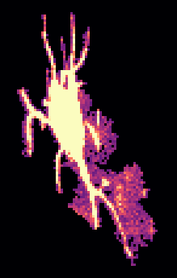<figcaption>#18 · 975 µm³ · 12 dendrites</figcaption></figure>
<figure class="cell-card" data-glb="../data/sample_2_1_ultrasonic_cleaned/cells/osteocyte_21.glb" data-validation="../data/sample_2_1_ultrasonic_cleaned/cells/osteocyte_21_dendrites" data-title="osteocyte 21: 7 dendrites">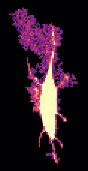<figcaption>#21 · 740 µm³ · 7 dendrites</figcaption></figure>
<figure class="cell-card" data-glb="../data/sample_2_1_ultrasonic_cleaned/cells/osteocyte_23.glb" data-validation="../data/sample_2_1_ultrasonic_cleaned/cells/osteocyte_23_dendrites" data-title="osteocyte 23: 6 dendrites">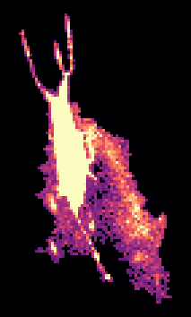<figcaption>#23 · 1051 µm³ · 6 dendrites</figcaption></figure>
<figure class="cell-card" data-glb="../data/sample_2_1_ultrasonic_cleaned/cells/osteocyte_26.glb" data-validation="../data/sample_2_1_ultrasonic_cleaned/cells/osteocyte_26_dendrites" data-title="osteocyte 26: 7 dendrites">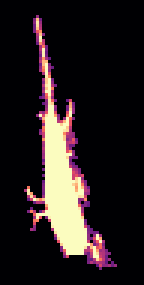<figcaption>#26 · 645 µm³ · 7 dendrites</figcaption></figure>
<figure class="cell-card" data-glb="../data/sample_2_1_ultrasonic_cleaned/cells/osteocyte_37.glb" data-validation="../data/sample_2_1_ultrasonic_cleaned/cells/osteocyte_37_dendrites" data-title="osteocyte 37: 7 dendrites">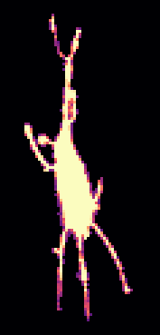<figcaption>#37 · 820 µm³ · 7 dendrites</figcaption></figure>
<figure class="cell-card" data-glb="../data/sample_2_1_ultrasonic_cleaned/cells/osteocyte_38.glb" data-validation="../data/sample_2_1_ultrasonic_cleaned/cells/osteocyte_38_dendrites" data-title="osteocyte 38: 6 dendrites">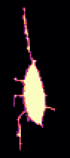<figcaption>#38 · 611 µm³ · 6 dendrites</figcaption></figure>
<figure class="cell-card" data-glb="../data/sample_2_1_ultrasonic_cleaned/cells/osteocyte_39.glb" data-validation="../data/sample_2_1_ultrasonic_cleaned/cells/osteocyte_39_dendrites" data-title="osteocyte 39: 9 dendrites">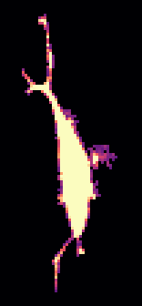<figcaption>#39 · 560 µm³ · 9 dendrites</figcaption></figure>
<figure class="cell-card" data-glb="../data/sample_2_1_ultrasonic_cleaned/cells/osteocyte_47.glb" data-validation="../data/sample_2_1_ultrasonic_cleaned/cells/osteocyte_47_dendrites" data-title="osteocyte 47: 3 dendrites">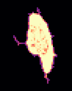<figcaption>#47 · 472 µm³ · 3 dendrites</figcaption></figure>
<figure class="cell-card" data-glb="../data/sample_2_1_ultrasonic_cleaned/cells/osteocyte_55.glb" data-validation="../data/sample_2_1_ultrasonic_cleaned/cells/osteocyte_55_dendrites" data-title="osteocyte 55: 10 dendrites"><figcaption>#55 · 758 µm³ · 10 dendrites</figcaption></figure>
<figure class="cell-card" data-glb="../data/sample_2_1_ultrasonic_cleaned/cells/osteocyte_61.glb" data-validation="../data/sample_2_1_ultrasonic_cleaned/cells/osteocyte_61_dendrites" data-title="osteocyte 61: 7 dendrites">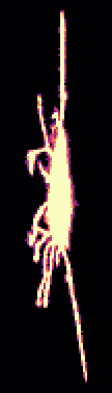<figcaption>#61 · 1432 µm³ · 7 dendrites</figcaption></figure>
<figure class="cell-card" data-glb="../data/sample_2_1_ultrasonic_cleaned/cells/osteocyte_74.glb" data-validation="../data/sample_2_1_ultrasonic_cleaned/cells/osteocyte_74_dendrites" data-title="osteocyte 74: 7 dendrites">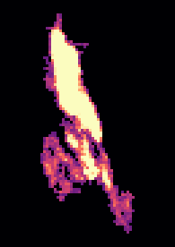<figcaption>#74 · 862 µm³ · 7 dendrites</figcaption></figure>
<figure class="cell-card" data-glb="../data/sample_2_1_ultrasonic_cleaned/cells/osteocyte_77.glb" data-validation="../data/sample_2_1_ultrasonic_cleaned/cells/osteocyte_77_dendrites" data-title="osteocyte 77: 9 dendrites">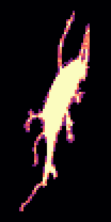<figcaption>#77 · 694 µm³ · 9 dendrites</figcaption></figure>
<figure class="cell-card" data-glb="../data/sample_2_1_ultrasonic_cleaned/cells/osteocyte_82.glb" data-validation="../data/sample_2_1_ultrasonic_cleaned/cells/osteocyte_82_dendrites" data-title="osteocyte 82: 5 dendrites">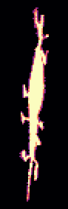<figcaption>#82 · 898 µm³ · 5 dendrites</figcaption></figure>
<figure class="cell-card" data-glb="../data/sample_2_1_ultrasonic_cleaned/cells/osteocyte_87.glb" data-validation="../data/sample_2_1_ultrasonic_cleaned/cells/osteocyte_87_dendrites" data-title="osteocyte 87: 11 dendrites">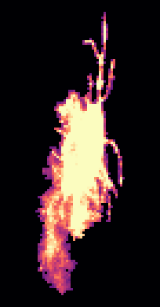<figcaption>#87 · 2613 µm³ · 11 dendrites</figcaption></figure>
<figure class="cell-card" data-glb="../data/sample_2_1_ultrasonic_cleaned/cells/osteocyte_117.glb" data-validation="../data/sample_2_1_ultrasonic_cleaned/cells/osteocyte_117_dendrites" data-title="osteocyte 117: 6 dendrites">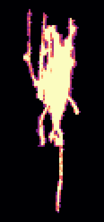<figcaption>#117 · 1538 µm³ · 6 dendrites</figcaption></figure>
<figure class="cell-card" data-glb="../data/sample_2_1_ultrasonic_cleaned/cells/osteocyte_124.glb" data-validation="../data/sample_2_1_ultrasonic_cleaned/cells/osteocyte_124_dendrites" data-title="osteocyte 124: 10 dendrites">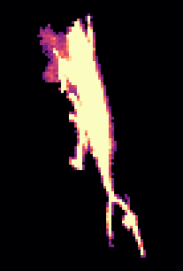<figcaption>#124 · 1501 µm³ · 10 dendrites</figcaption></figure>
<figure class="cell-card" data-glb="../data/sample_2_1_ultrasonic_cleaned/cells/osteocyte_134.glb" data-validation="../data/sample_2_1_ultrasonic_cleaned/cells/osteocyte_134_dendrites" data-title="osteocyte 134: 7 dendrites"><figcaption>#134 · 1279 µm³ · 7 dendrites</figcaption></figure>
<figure class="cell-card" data-glb="../data/sample_2_1_ultrasonic_cleaned/cells/osteocyte_140.glb" data-validation="../data/sample_2_1_ultrasonic_cleaned/cells/osteocyte_140_dendrites" data-title="osteocyte 140: 5 dendrites">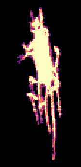<figcaption>#140 · 1254 µm³ · 5 dendrites</figcaption></figure>
<figure class="cell-card" data-glb="../data/sample_2_1_ultrasonic_cleaned/cells/osteocyte_146.glb" data-validation="../data/sample_2_1_ultrasonic_cleaned/cells/osteocyte_146_dendrites" data-title="osteocyte 146: 3 dendrites">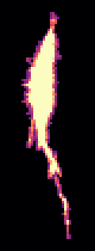<figcaption>#146 · 629 µm³ · 3 dendrites</figcaption></figure>
<figure class="cell-card" data-glb="../data/sample_2_1_ultrasonic_cleaned/cells/osteocyte_150.glb" data-validation="../data/sample_2_1_ultrasonic_cleaned/cells/osteocyte_150_dendrites" data-title="osteocyte 150: 5 dendrites">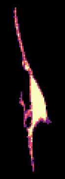<figcaption>#150 · 430 µm³ · 5 dendrites</figcaption></figure>
<figure class="cell-card" data-glb="../data/sample_2_1_ultrasonic_cleaned/cells/osteocyte_160.glb" data-validation="../data/sample_2_1_ultrasonic_cleaned/cells/osteocyte_160_dendrites" data-title="osteocyte 160: 8 dendrites">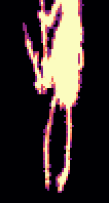<figcaption>#160 · 1651 µm³ · 8 dendrites</figcaption></figure>
</div>
<dialog id="cell-dialog"><form method="dialog"><button class="close" aria-label="close">×</button></form>
<h3 class="cell-title"></h3>
<div class="cell-panels">
<model-viewer camera-controls interaction-prompt="none" shadow-intensity="0" class="cell-viewer"></model-viewer>
<figure class="cell-validation">
<figcaption><span class="key" style="--c:#9a9893"></span>body <span class="key" style="--c:#2a78d6"></span>dendrite (counted)
<span class="key" style="--c:#1baf7a"></span>flat part of the body <span class="key" style="--c:#eb6834"></span>short protrusion
· <a class="validation-png" target="_blank">projections (PNG)</a></figcaption></figure>
</div></dialog>
```
