<!-- generated by scripts/build_pages.py from data/sample_3_1/; edits are overwritten -->

Voxel size 0.4815 µm (cubic) · volume 51 × 512 × 512 voxels (z, y, x) = 25 × 247 × 247 µm ·
exported 2026-10-07 from `Texas red 20min_24.8.2026.lif`.

Downloads: [osteocyte_props.csv](../data/sample_3_1/osteocyte_props.csv) · [dendrites.csv](../data/sample_3_1/dendrites.csv) · [summary.log](../data/sample_3_1/summary.log) · [summary.json](../data/sample_3_1/summary.json) · [scene.glb](../data/sample_3_1/scene.glb) · [scene_obj.zip](../data/sample_3_1/scene_obj.zip)

## 3D scene

Drag to rotate, scroll to zoom, right-drag to pan. One colour per osteocyte; cleaned ch0 nuclei inside the hull
(bone side) in translucent blue. Depth (z) points up. `scene_obj.zip` has the same scene as OBJ + MTL in µm,
with and without the nuclei.

```{=html}
<button class="btn btn-sm btn-outline-secondary nuclei-toggle" aria-pressed="true" data-target="scene" data-opacity="0.35">Nuclei: shown</button>
<model-viewer id="scene" src="../data/sample_3_1/scene.glb" alt="sample 3.1 osteocytes and nuclei" camera-controls touch-action="pan-y" interaction-prompt="none" shadow-intensity="0" exposure="1.1" class="scene-viewer" camera-orbit="0deg 35deg auto"></model-viewer>
```

## Pipeline counts

| stage | count |
|:--|--:|
| watershed regions | 40 |
| &gt;= 100 voxels and &gt; 0 vox inside xy hull (pass 1) | 30 |
| &gt; -10 vox inside hull without soft tissue (pass 2) | 30 |
| removed: far side of soft tissue | 1 |
| removed: no nucleus | 6 |
| split by nuclei | 0 |
| removed: flat | 0 |
| surviving osteocytes | 23 |
| nuclei (cleaned ch0) | 48 |
| inside hull, bone side | 43 |
| detected | 23 |
| soft tissue | 1 |
| labelled, rejected | 9 |
| no ch1 label | 10 |
| inside hull, not labelled as osteocyte (rejected + no ch1) | 19 |

## Osteocytes

```{=html}
<table class="datatable">
<thead><tr><th>label</th><th>volume (µm³)</th><th>surface (µm²)</th><th>axis 1 (µm)</th><th>axis 2 (µm)</th><th>axis 3 (µm)</th><th>flatness</th><th>nuclei</th><th>nucleus (µm³)</th><th>dendrites</th><th>reach mean (µm)</th><th>reach sd (µm)</th><th>reach max (µm)</th><th>path mean (µm)</th></tr></thead>
<tbody>
<tr><td>1</td><td>401</td><td>1016</td><td>40.60</td><td>11.44</td><td>3.19</td><td>0.28</td><td>1</td><td>55.14</td><td>6</td><td>5.83</td><td>4.83</td><td>15.17</td><td>22.59</td></tr>
<tr><td>2</td><td>382</td><td>683</td><td>24.84</td><td>13.65</td><td>5.14</td><td>0.38</td><td>1</td><td>68.86</td><td>10</td><td>6.12</td><td>3.23</td><td>13.22</td><td>5.51</td></tr>
<tr><td>3</td><td>347</td><td>914</td><td>26.66</td><td>19.51</td><td>2.96</td><td>0.15</td><td>1</td><td>43.31</td><td>3</td><td>6.46</td><td>5.90</td><td>13.18</td><td>56.80</td></tr>
<tr><td>4</td><td>111</td><td>240</td><td>12.96</td><td>6.27</td><td>4.46</td><td>0.71</td><td>1</td><td>74.22</td><td>1</td><td>2.46</td><td></td><td>2.46</td><td>9.32</td></tr>
<tr><td>5</td><td>360</td><td>684</td><td>36.07</td><td>8.34</td><td>4.73</td><td>0.57</td><td>1</td><td>66.52</td><td>6</td><td>7.22</td><td>6.02</td><td>16.26</td><td>13.36</td></tr>
<tr><td>6</td><td>525</td><td>1058</td><td>38.99</td><td>12.95</td><td>5.02</td><td>0.39</td><td>1</td><td>62.73</td><td>10</td><td>7.68</td><td>4.99</td><td>17.85</td><td>13.67</td></tr>
<tr><td>7</td><td>604</td><td>1245</td><td>58.33</td><td>9.79</td><td>7.00</td><td>0.71</td><td>1</td><td>61.27</td><td>6</td><td>10.65</td><td>9.17</td><td>24.31</td><td>31.62</td></tr>
<tr><td>8</td><td>927</td><td>1524</td><td>40.83</td><td>11.08</td><td>8.29</td><td>0.75</td><td>1</td><td>54.47</td><td>8</td><td>10.62</td><td>6.83</td><td>25.06</td><td>21.22</td></tr>
<tr><td>10</td><td>589</td><td>1019</td><td>33.02</td><td>13.92</td><td>5.89</td><td>0.42</td><td>1</td><td>72.55</td><td>9</td><td>6.65</td><td>2.76</td><td>10.21</td><td>11.88</td></tr>
<tr><td>12</td><td>372</td><td>615</td><td>28.57</td><td>7.38</td><td>5.74</td><td>0.78</td><td>1</td><td>68.64</td><td>6</td><td>5.53</td><td>3.25</td><td>11.81</td><td>7.89</td></tr>
<tr><td>13</td><td>1024</td><td>2217</td><td>40.54</td><td>26.57</td><td>10.10</td><td>0.38</td><td>1</td><td>57.93</td><td>11</td><td>8.09</td><td>6.05</td><td>20.73</td><td>30.69</td></tr>
<tr><td>14</td><td>833</td><td>1967</td><td>45.88</td><td>22.09</td><td>4.14</td><td>0.19</td><td>1</td><td>54.69</td><td>5</td><td>5.43</td><td>4.13</td><td>11.34</td><td>58.87</td></tr>
<tr><td>16</td><td>586</td><td>1400</td><td>67.43</td><td>10.77</td><td>4.28</td><td>0.40</td><td>1</td><td>57.81</td><td>7</td><td>11.03</td><td>11.01</td><td>33.04</td><td>27.78</td></tr>
<tr><td>17</td><td>340</td><td>665</td><td>26.28</td><td>9.98</td><td>6.64</td><td>0.67</td><td>1</td><td>62.95</td><td>4</td><td>6.22</td><td>2.49</td><td>9.41</td><td>18.32</td></tr>
<tr><td>19</td><td>647</td><td>1225</td><td>36.60</td><td>11.09</td><td>7.52</td><td>0.68</td><td>1</td><td>68.75</td><td>12</td><td>7.08</td><td>4.52</td><td>18.50</td><td>11.52</td></tr>
<tr><td>22</td><td>527</td><td>570</td><td>19.47</td><td>10.01</td><td>6.14</td><td>0.61</td><td>1</td><td>64.18</td><td>1</td><td>2.41</td><td></td><td>2.41</td><td>5.51</td></tr>
<tr><td>26</td><td>621</td><td>1298</td><td>26.88</td><td>24.29</td><td>6.64</td><td>0.27</td><td>1</td><td>46.21</td><td>5</td><td>3.81</td><td>2.21</td><td>7.27</td><td>31.41</td></tr>
<tr><td>27</td><td>483</td><td>836</td><td>36.06</td><td>9.46</td><td>5.18</td><td>0.55</td><td>1</td><td>66.63</td><td>7</td><td>7.51</td><td>3.48</td><td>12.08</td><td>10.01</td></tr>
<tr><td>35</td><td>335</td><td>626</td><td>24.08</td><td>8.94</td><td>5.54</td><td>0.62</td><td>1</td><td>62.39</td><td>6</td><td>3.61</td><td>1.00</td><td>4.54</td><td>5.52</td></tr>
<tr><td>41</td><td>716</td><td>1732</td><td>46.74</td><td>17.90</td><td>6.59</td><td>0.37</td><td>1</td><td>47.10</td><td>5</td><td>5.93</td><td>4.62</td><td>12.99</td><td>48.14</td></tr>
<tr><td>43</td><td>604</td><td>1346</td><td>44.33</td><td>12.44</td><td>4.49</td><td>0.36</td><td>1</td><td>85.16</td><td>2</td><td>12.68</td><td>12.71</td><td>21.67</td><td>103</td></tr>
<tr><td>46</td><td>354</td><td>705</td><td>40.36</td><td>5.25</td><td>4.86</td><td>0.93</td><td>1</td><td>53.69</td><td>3</td><td>6.56</td><td>2.53</td><td>9.15</td><td>22.08</td></tr>
<tr><td>48</td><td>205</td><td>275</td><td>17.34</td><td>6.94</td><td>3.83</td><td>0.55</td><td>1</td><td>57.26</td><td>0</td><td></td><td></td><td></td><td></td></tr>
</tbody>
</table>
```

## Gallery

Rotating maximum-intensity projections of ch1 inside each osteocyte. Click a cell for its 3D mesh.

```{=html}
<div class="gallery">
<figure class="cell-card" data-glb="../data/sample_3_1/cells/osteocyte_1.glb" data-title="osteocyte 1">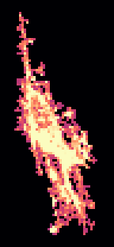<figcaption>#1 · 401 µm³ · 6 dendrites</figcaption></figure>
<figure class="cell-card" data-glb="../data/sample_3_1/cells/osteocyte_2.glb" data-title="osteocyte 2"><figcaption>#2 · 382 µm³ · 10 dendrites</figcaption></figure>
<figure class="cell-card" data-glb="../data/sample_3_1/cells/osteocyte_3.glb" data-title="osteocyte 3">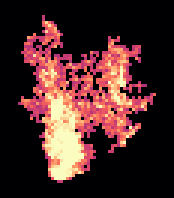<figcaption>#3 · 347 µm³ · 3 dendrites</figcaption></figure>
<figure class="cell-card" data-glb="../data/sample_3_1/cells/osteocyte_4.glb" data-title="osteocyte 4"><figcaption>#4 · 111 µm³ · 1 dendrites</figcaption></figure>
<figure class="cell-card" data-glb="../data/sample_3_1/cells/osteocyte_5.glb" data-title="osteocyte 5">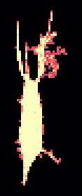<figcaption>#5 · 360 µm³ · 6 dendrites</figcaption></figure>
<figure class="cell-card" data-glb="../data/sample_3_1/cells/osteocyte_6.glb" data-title="osteocyte 6">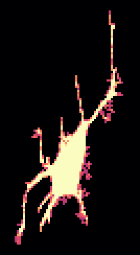<figcaption>#6 · 525 µm³ · 10 dendrites</figcaption></figure>
<figure class="cell-card" data-glb="../data/sample_3_1/cells/osteocyte_7.glb" data-title="osteocyte 7"><figcaption>#7 · 604 µm³ · 6 dendrites</figcaption></figure>
<figure class="cell-card" data-glb="../data/sample_3_1/cells/osteocyte_8.glb" data-title="osteocyte 8">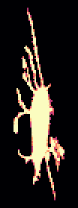<figcaption>#8 · 927 µm³ · 8 dendrites</figcaption></figure>
<figure class="cell-card" data-glb="../data/sample_3_1/cells/osteocyte_10.glb" data-title="osteocyte 10"><figcaption>#10 · 589 µm³ · 9 dendrites</figcaption></figure>
<figure class="cell-card" data-glb="../data/sample_3_1/cells/osteocyte_12.glb" data-title="osteocyte 12"><figcaption>#12 · 372 µm³ · 6 dendrites</figcaption></figure>
<figure class="cell-card" data-glb="../data/sample_3_1/cells/osteocyte_13.glb" data-title="osteocyte 13">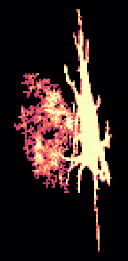<figcaption>#13 · 1024 µm³ · 11 dendrites</figcaption></figure>
<figure class="cell-card" data-glb="../data/sample_3_1/cells/osteocyte_14.glb" data-title="osteocyte 14">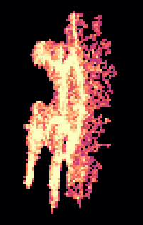<figcaption>#14 · 833 µm³ · 5 dendrites</figcaption></figure>
<figure class="cell-card" data-glb="../data/sample_3_1/cells/osteocyte_16.glb" data-title="osteocyte 16">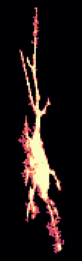<figcaption>#16 · 586 µm³ · 7 dendrites</figcaption></figure>
<figure class="cell-card" data-glb="../data/sample_3_1/cells/osteocyte_17.glb" data-title="osteocyte 17"><figcaption>#17 · 340 µm³ · 4 dendrites</figcaption></figure>
<figure class="cell-card" data-glb="../data/sample_3_1/cells/osteocyte_19.glb" data-title="osteocyte 19"><figcaption>#19 · 647 µm³ · 12 dendrites</figcaption></figure>
<figure class="cell-card" data-glb="../data/sample_3_1/cells/osteocyte_22.glb" data-title="osteocyte 22">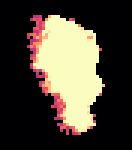<figcaption>#22 · 527 µm³ · 1 dendrites</figcaption></figure>
<figure class="cell-card" data-glb="../data/sample_3_1/cells/osteocyte_26.glb" data-title="osteocyte 26">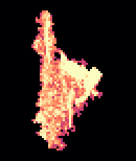<figcaption>#26 · 621 µm³ · 5 dendrites</figcaption></figure>
<figure class="cell-card" data-glb="../data/sample_3_1/cells/osteocyte_27.glb" data-title="osteocyte 27"><figcaption>#27 · 483 µm³ · 7 dendrites</figcaption></figure>
<figure class="cell-card" data-glb="../data/sample_3_1/cells/osteocyte_35.glb" data-title="osteocyte 35"><figcaption>#35 · 335 µm³ · 6 dendrites</figcaption></figure>
<figure class="cell-card" data-glb="../data/sample_3_1/cells/osteocyte_41.glb" data-title="osteocyte 41">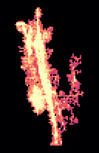<figcaption>#41 · 716 µm³ · 5 dendrites</figcaption></figure>
<figure class="cell-card" data-glb="../data/sample_3_1/cells/osteocyte_43.glb" data-title="osteocyte 43">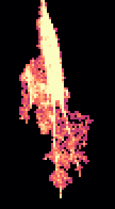<figcaption>#43 · 604 µm³ · 2 dendrites</figcaption></figure>
<figure class="cell-card" data-glb="../data/sample_3_1/cells/osteocyte_46.glb" data-title="osteocyte 46"><figcaption>#46 · 354 µm³ · 3 dendrites</figcaption></figure>
<figure class="cell-card" data-glb="../data/sample_3_1/cells/osteocyte_48.glb" data-title="osteocyte 48"><figcaption>#48 · 205 µm³ · 0 dendrites</figcaption></figure>
</div>
<dialog id="cell-dialog"><form method="dialog"><button class="close" aria-label="close">×</button></form>
<h3 class="cell-title"></h3><model-viewer camera-controls interaction-prompt="none" shadow-intensity="0" class="cell-viewer"></model-viewer></dialog>
```
