<!-- generated by scripts/build_pages.py from data/sample_3_2/; edits are overwritten -->

Voxel size 0.4471 µm (cubic) · volume 78 × 512 × 512 voxels (z, y, x) = 35 × 229 × 229 µm ·
exported 2026-10-07 from `Texas red 20min_24.8.2026.lif`.

Downloads: [osteocyte_props.csv](../data/sample_3_2/osteocyte_props.csv) · [dendrites.csv](../data/sample_3_2/dendrites.csv) · [summary.log](../data/sample_3_2/summary.log) · [summary.json](../data/sample_3_2/summary.json) · [scene.glb](../data/sample_3_2/scene.glb) · [scene_obj.zip](../data/sample_3_2/scene_obj.zip)

## 3D scene

Drag to rotate, scroll to zoom, right-drag to pan. One colour per osteocyte; cleaned ch0 nuclei inside the hull
(bone side) in translucent blue. Depth (z) points up. `scene_obj.zip` has the same scene as OBJ + MTL in µm,
with and without the nuclei.

```{=html}
<button class="btn btn-sm btn-outline-secondary nuclei-toggle" aria-pressed="true" data-target="scene" data-opacity="0.35">Nuclei: shown</button>
<model-viewer id="scene" src="../data/sample_3_2/scene.glb" alt="sample 3.2 osteocytes and nuclei" camera-controls touch-action="pan-y" interaction-prompt="none" shadow-intensity="0" exposure="1.1" class="scene-viewer" camera-orbit="0deg 35deg auto"></model-viewer>
```

## Pipeline counts

| stage | count |
|:--|--:|
| watershed regions | 87 |
| &gt;= 100 voxels and &gt; 0 vox inside xy hull (pass 1) | 45 |
| &gt; -10 vox inside hull without soft tissue (pass 2) | 45 |
| removed: far side of soft tissue | 2 |
| removed: no nucleus | 16 |
| split by nuclei | 0 |
| removed: flat | 0 |
| surviving osteocytes | 27 |
| nuclei (cleaned ch0) | 91 |
| inside hull, bone side | 57 |
| detected | 26 |
| soft tissue | 22 |
| labelled, rejected | 4 |
| no ch1 label | 5 |
| inside hull, not labelled as osteocyte (rejected + no ch1) | 9 |

## Osteocytes

```{=html}
<table class="datatable">
<thead><tr><th>label</th><th>volume (µm³)</th><th>surface (µm²)</th><th>axis 1 (µm)</th><th>axis 2 (µm)</th><th>axis 3 (µm)</th><th>flatness</th><th>nuclei</th><th>nucleus (µm³)</th><th>dendrites</th><th>reach mean (µm)</th><th>reach sd (µm)</th><th>reach max (µm)</th><th>path mean (µm)</th></tr></thead>
<tbody>
<tr><td>9</td><td>291</td><td>546</td><td>34.48</td><td>5.96</td><td>4.52</td><td>0.76</td><td>1</td><td>46.83</td><td>4</td><td>5.77</td><td>5.49</td><td>13.92</td><td>10.44</td></tr>
<tr><td>13</td><td>459</td><td>961</td><td>28.78</td><td>20.74</td><td>5.32</td><td>0.26</td><td>1</td><td>44.78</td><td>7</td><td>4.86</td><td>3.31</td><td>11.74</td><td>13.79</td></tr>
<tr><td>15</td><td>727</td><td>1223</td><td>42.76</td><td>9.66</td><td>6.48</td><td>0.67</td><td>1</td><td>95.99</td><td>7</td><td>11.92</td><td>6.80</td><td>22.09</td><td>16.36</td></tr>
<tr><td>19</td><td>315</td><td>609</td><td>35.20</td><td>5.33</td><td>4.93</td><td>0.93</td><td>1</td><td>39.06</td><td>5</td><td>4.61</td><td>3.48</td><td>10.66</td><td>10.37</td></tr>
<tr><td>23</td><td>366</td><td>648</td><td>32.28</td><td>8.74</td><td>5.35</td><td>0.61</td><td>1</td><td>48.08</td><td>5</td><td>7.83</td><td>4.35</td><td>15.06</td><td>13.08</td></tr>
<tr><td>27</td><td>870</td><td>1241</td><td>35.46</td><td>10.50</td><td>8.41</td><td>0.80</td><td>1</td><td>42.01</td><td>6</td><td>11.18</td><td>9.48</td><td>25.56</td><td>15.88</td></tr>
<tr><td>29</td><td>832</td><td>1926</td><td>37.55</td><td>16.23</td><td>7.95</td><td>0.49</td><td>1</td><td>23.33</td><td>14</td><td>3.79</td><td>1.97</td><td>8.35</td><td>14.96</td></tr>
<tr><td>30</td><td>306</td><td>503</td><td>25.91</td><td>8.57</td><td>4.82</td><td>0.56</td><td>1</td><td>49.78</td><td>4</td><td>4.98</td><td>3.02</td><td>9.22</td><td>7.74</td></tr>
<tr><td>35</td><td>376</td><td>817</td><td>26.96</td><td>8.92</td><td>5.88</td><td>0.66</td><td>1</td><td>33.60</td><td>4</td><td>4.18</td><td>0.64</td><td>4.58</td><td>25.17</td></tr>
<tr><td>36</td><td>358</td><td>509</td><td>16.82</td><td>7.97</td><td>6.47</td><td>0.81</td><td>1</td><td>41.47</td><td>1</td><td>5.38</td><td></td><td>5.38</td><td>20.66</td></tr>
<tr><td>47</td><td>436</td><td>882</td><td>46.32</td><td>9.80</td><td>8.60</td><td>0.88</td><td>1</td><td>34.41</td><td>6</td><td>6.32</td><td>1.73</td><td>8.02</td><td>15.14</td></tr>
<tr><td>49</td><td>276</td><td>490</td><td>29.48</td><td>10.03</td><td>5.50</td><td>0.55</td><td>1</td><td>42.18</td><td>3</td><td>7.59</td><td>2.90</td><td>9.60</td><td>10.50</td></tr>
<tr><td>54</td><td>281</td><td>405</td><td>21.80</td><td>6.15</td><td>4.69</td><td>0.76</td><td>1</td><td>39.95</td><td>2</td><td>6.37</td><td>3.17</td><td>8.61</td><td>5.53</td></tr>
<tr><td>57</td><td>598</td><td>1285</td><td>25.05</td><td>15.50</td><td>6.91</td><td>0.45</td><td>1</td><td>31.46</td><td>6</td><td>5.53</td><td>3.32</td><td>10.62</td><td>32.18</td></tr>
<tr><td>60</td><td>387</td><td>913</td><td>32.65</td><td>9.10</td><td>7.68</td><td>0.84</td><td>1</td><td>31.55</td><td>7</td><td>6.21</td><td>5.69</td><td>18.82</td><td>16.56</td></tr>
<tr><td>61</td><td>264</td><td>429</td><td>22.91</td><td>5.99</td><td>5.06</td><td>0.84</td><td>1</td><td>39.68</td><td>2</td><td>3.95</td><td>2.36</td><td>5.62</td><td>5.68</td></tr>
<tr><td>63</td><td>1365</td><td>3802</td><td>66.39</td><td>23.22</td><td>12.73</td><td>0.55</td><td>1</td><td>30.21</td><td>6</td><td>8.90</td><td>6.34</td><td>19.74</td><td>121</td></tr>
<tr><td>64</td><td>280</td><td>462</td><td>25.25</td><td>7.66</td><td>4.35</td><td>0.57</td><td>1</td><td>30.21</td><td>4</td><td>3.61</td><td>1.55</td><td>5.88</td><td>2.85</td></tr>
<tr><td>71</td><td>612</td><td>1298</td><td>69.82</td><td>8.78</td><td>6.41</td><td>0.73</td><td>1</td><td>26.28</td><td>9</td><td>12.04</td><td>12.75</td><td>34.14</td><td>17.48</td></tr>
<tr><td>76</td><td>231</td><td>328</td><td>19.95</td><td>6.99</td><td>3.60</td><td>0.52</td><td>1</td><td>36.02</td><td>1</td><td>2.24</td><td></td><td>2.24</td><td>0</td></tr>
<tr><td>87</td><td>123</td><td>331</td><td>24.79</td><td>4.26</td><td>3.36</td><td>0.79</td><td>1</td><td>30.48</td><td>4</td><td>3.72</td><td>2.37</td><td>7.26</td><td>5.53</td></tr>
<tr><td>88</td><td>250</td><td>501</td><td>31.11</td><td>9.71</td><td>5.07</td><td>0.52</td><td>1</td><td>24.94</td><td>7</td><td>3.17</td><td>1.52</td><td>6.51</td><td>3.22</td></tr>
<tr><td>94</td><td>425</td><td>579</td><td>24.96</td><td>6.91</td><td>5.50</td><td>0.80</td><td>1</td><td>32.62</td><td>5</td><td>3.74</td><td>1.43</td><td>5.55</td><td>2.48</td></tr>
<tr><td>101</td><td>410</td><td>621</td><td>32.19</td><td>6.85</td><td>5.09</td><td>0.74</td><td>1</td><td>28.42</td><td>3</td><td>6.54</td><td>2.83</td><td>9.47</td><td>8.67</td></tr>
<tr><td>106</td><td>302</td><td>417</td><td>25.95</td><td>6.00</td><td>4.28</td><td>0.71</td><td>1</td><td>33.25</td><td>2</td><td>2.59</td><td>0.76</td><td>3.13</td><td>0.76</td></tr>
<tr><td>115</td><td>342</td><td>617</td><td>17.31</td><td>11.37</td><td>5.19</td><td>0.46</td><td>1</td><td>24.76</td><td>4</td><td>3.78</td><td>0.39</td><td>4.31</td><td>14.34</td></tr>
<tr><td>119</td><td>210</td><td>382</td><td>28.00</td><td>4.89</td><td>4.31</td><td>0.88</td><td>1</td><td>28.24</td><td>3</td><td>2.62</td><td>0.34</td><td>2.86</td><td>2.37</td></tr>
</tbody>
</table>
```

## Gallery

Rotating maximum-intensity projections of ch1 inside each osteocyte. Click a cell for its 3D mesh.

```{=html}
<div class="gallery">
<figure class="cell-card" data-glb="../data/sample_3_2/cells/osteocyte_9.glb" data-title="osteocyte 9"><figcaption>#9 · 291 µm³ · 4 dendrites</figcaption></figure>
<figure class="cell-card" data-glb="../data/sample_3_2/cells/osteocyte_13.glb" data-title="osteocyte 13">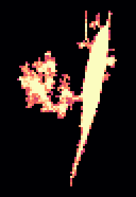<figcaption>#13 · 459 µm³ · 7 dendrites</figcaption></figure>
<figure class="cell-card" data-glb="../data/sample_3_2/cells/osteocyte_15.glb" data-title="osteocyte 15">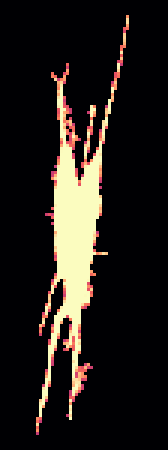<figcaption>#15 · 727 µm³ · 7 dendrites</figcaption></figure>
<figure class="cell-card" data-glb="../data/sample_3_2/cells/osteocyte_19.glb" data-title="osteocyte 19">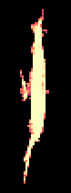<figcaption>#19 · 315 µm³ · 5 dendrites</figcaption></figure>
<figure class="cell-card" data-glb="../data/sample_3_2/cells/osteocyte_23.glb" data-title="osteocyte 23"><figcaption>#23 · 366 µm³ · 5 dendrites</figcaption></figure>
<figure class="cell-card" data-glb="../data/sample_3_2/cells/osteocyte_27.glb" data-title="osteocyte 27"><figcaption>#27 · 870 µm³ · 6 dendrites</figcaption></figure>
<figure class="cell-card" data-glb="../data/sample_3_2/cells/osteocyte_29.glb" data-title="osteocyte 29">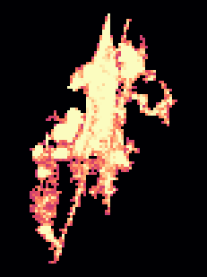<figcaption>#29 · 832 µm³ · 14 dendrites</figcaption></figure>
<figure class="cell-card" data-glb="../data/sample_3_2/cells/osteocyte_30.glb" data-title="osteocyte 30"><figcaption>#30 · 306 µm³ · 4 dendrites</figcaption></figure>
<figure class="cell-card" data-glb="../data/sample_3_2/cells/osteocyte_35.glb" data-title="osteocyte 35">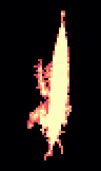<figcaption>#35 · 376 µm³ · 4 dendrites</figcaption></figure>
<figure class="cell-card" data-glb="../data/sample_3_2/cells/osteocyte_36.glb" data-title="osteocyte 36"><figcaption>#36 · 358 µm³ · 1 dendrites</figcaption></figure>
<figure class="cell-card" data-glb="../data/sample_3_2/cells/osteocyte_47.glb" data-title="osteocyte 47">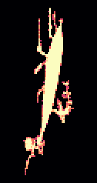<figcaption>#47 · 436 µm³ · 6 dendrites</figcaption></figure>
<figure class="cell-card" data-glb="../data/sample_3_2/cells/osteocyte_49.glb" data-title="osteocyte 49"><figcaption>#49 · 276 µm³ · 3 dendrites</figcaption></figure>
<figure class="cell-card" data-glb="../data/sample_3_2/cells/osteocyte_54.glb" data-title="osteocyte 54"><figcaption>#54 · 281 µm³ · 2 dendrites</figcaption></figure>
<figure class="cell-card" data-glb="../data/sample_3_2/cells/osteocyte_57.glb" data-title="osteocyte 57">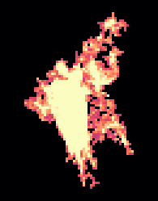<figcaption>#57 · 598 µm³ · 6 dendrites</figcaption></figure>
<figure class="cell-card" data-glb="../data/sample_3_2/cells/osteocyte_60.glb" data-title="osteocyte 60"><figcaption>#60 · 387 µm³ · 7 dendrites</figcaption></figure>
<figure class="cell-card" data-glb="../data/sample_3_2/cells/osteocyte_61.glb" data-title="osteocyte 61"><figcaption>#61 · 264 µm³ · 2 dendrites</figcaption></figure>
<figure class="cell-card" data-glb="../data/sample_3_2/cells/osteocyte_63.glb" data-title="osteocyte 63">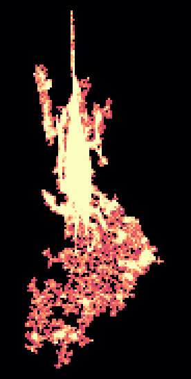<figcaption>#63 · 1365 µm³ · 6 dendrites</figcaption></figure>
<figure class="cell-card" data-glb="../data/sample_3_2/cells/osteocyte_64.glb" data-title="osteocyte 64">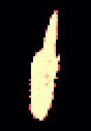<figcaption>#64 · 280 µm³ · 4 dendrites</figcaption></figure>
<figure class="cell-card" data-glb="../data/sample_3_2/cells/osteocyte_71.glb" data-title="osteocyte 71">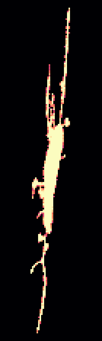<figcaption>#71 · 612 µm³ · 9 dendrites</figcaption></figure>
<figure class="cell-card" data-glb="../data/sample_3_2/cells/osteocyte_76.glb" data-title="osteocyte 76">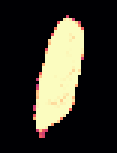<figcaption>#76 · 231 µm³ · 1 dendrites</figcaption></figure>
<figure class="cell-card" data-glb="../data/sample_3_2/cells/osteocyte_87.glb" data-title="osteocyte 87"><figcaption>#87 · 123 µm³ · 4 dendrites</figcaption></figure>
<figure class="cell-card" data-glb="../data/sample_3_2/cells/osteocyte_88.glb" data-title="osteocyte 88">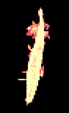<figcaption>#88 · 250 µm³ · 7 dendrites</figcaption></figure>
<figure class="cell-card" data-glb="../data/sample_3_2/cells/osteocyte_94.glb" data-title="osteocyte 94"><figcaption>#94 · 425 µm³ · 5 dendrites</figcaption></figure>
<figure class="cell-card" data-glb="../data/sample_3_2/cells/osteocyte_101.glb" data-title="osteocyte 101"><figcaption>#101 · 410 µm³ · 3 dendrites</figcaption></figure>
<figure class="cell-card" data-glb="../data/sample_3_2/cells/osteocyte_106.glb" data-title="osteocyte 106"><figcaption>#106 · 302 µm³ · 2 dendrites</figcaption></figure>
<figure class="cell-card" data-glb="../data/sample_3_2/cells/osteocyte_115.glb" data-title="osteocyte 115"><figcaption>#115 · 342 µm³ · 4 dendrites</figcaption></figure>
<figure class="cell-card" data-glb="../data/sample_3_2/cells/osteocyte_119.glb" data-title="osteocyte 119"><figcaption>#119 · 210 µm³ · 3 dendrites</figcaption></figure>
</div>
<dialog id="cell-dialog"><form method="dialog"><button class="close" aria-label="close">×</button></form>
<h3 class="cell-title"></h3><model-viewer camera-controls interaction-prompt="none" shadow-intensity="0" class="cell-viewer"></model-viewer></dialog>
```
