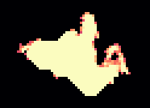
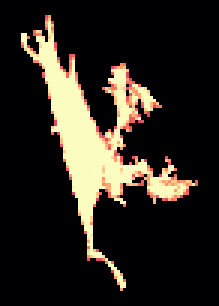
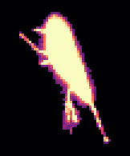
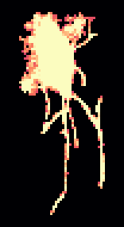
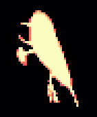

<!-- generated by scripts/build_pages.py from data/sample_4_1/; edits are overwritten -->

Voxel size 0.4471 µm (cubic) · volume 74 × 512 × 512 voxels (z, y, x) = 33 × 229 × 229 µm ·
exported 2026-10-15 from `Texas red 20min_24.8.2026.lif`.

Downloads: [osteocyte_props.csv](../data/sample_4_1/osteocyte_props.csv) · [dendrites.csv](../data/sample_4_1/dendrites.csv) · [summary.log](../data/sample_4_1/summary.log) · [summary.json](../data/sample_4_1/summary.json) · [scene.glb](../data/sample_4_1/scene.glb) · [scene_obj.zip](../data/sample_4_1/scene_obj.zip)

## 3D scene

Drag to rotate, scroll to zoom, right-drag to pan. One colour per osteocyte; cleaned ch0 nuclei inside the hull
(bone side) in translucent blue. Depth (z) points up. `scene_obj.zip` has the same scene as OBJ + MTL in µm,
with and without the nuclei.

```{=html}
<button class="btn btn-sm btn-outline-secondary nuclei-toggle" aria-pressed="true" data-target="scene" data-opacity="0.35">Nuclei: shown</button>
<model-viewer id="scene" src="../data/sample_4_1/scene.glb" alt="sample 4.1 osteocytes and nuclei" camera-controls touch-action="pan-y" interaction-prompt="none" shadow-intensity="0" exposure="1.1" class="scene-viewer" camera-orbit="0deg 35deg auto"></model-viewer>
```

## Pipeline counts

| stage | count |
|:--|--:|
| watershed regions | 52 |
| &gt;= 100 voxels and &gt; 0 vox inside xy hull (pass 1) | 24 |
| &gt; 0 vox inside hull without soft tissue (pass 2) | 16 |
| removed: far side of soft tissue | 1 |
| removed: no nucleus | 6 |
| split by nuclei | 0 |
| removed: flat | 0 |
| surviving osteocytes | 9 |
| nuclei (cleaned ch0) | 22 |
| inside hull, bone side | 15 |
| detected | 9 |
| soft tissue | 2 |
| labelled, rejected | 2 |
| no ch1 label | 2 |
| inside hull, not labelled as osteocyte (rejected + no ch1) | 4 |
| protrusions reaching &gt;= 2.0 µm | 48 |
| dendrites (rods, counted) | 46 |
| flat parts of the body (sheets, not counted) | 2 |

## Osteocytes

```{=html}
<table class="datatable">
<thead><tr><th>label</th><th>volume (µm³)</th><th>surface (µm²)</th><th>axis 1 (µm)</th><th>axis 2 (µm)</th><th>axis 3 (µm)</th><th>flatness</th><th>nuclei</th><th>nucleus (µm³)</th><th>dendrites</th><th>reach mean (µm)</th><th>reach sd (µm)</th><th>reach max (µm)</th><th>path mean (µm)</th></tr></thead>
<tbody>
<tr><td>10</td><td>627</td><td>688</td><td>18.62</td><td>11.95</td><td>7.87</td><td>0.66</td><td>1</td><td>56.48</td><td>4</td><td>5.24</td><td>2.30</td><td>7.22</td><td>5.51</td></tr>
<tr><td>11</td><td>841</td><td>1203</td><td>28.72</td><td>14.55</td><td>7.53</td><td>0.52</td><td>1</td><td>53.27</td><td>8</td><td>4.93</td><td>2.41</td><td>8.61</td><td>8.77</td></tr>
<tr><td>12</td><td>337</td><td>437</td><td>15.87</td><td>10.73</td><td>5.60</td><td>0.52</td><td>1</td><td>18.86</td><td>0</td><td></td><td></td><td></td><td></td></tr>
<tr><td>16</td><td>787</td><td>809</td><td>17.38</td><td>12.74</td><td>9.91</td><td>0.78</td><td>1</td><td>20.47</td><td>2</td><td>2.91</td><td>1.14</td><td>3.71</td><td>8.20</td></tr>
<tr><td>24</td><td>699</td><td>1219</td><td>33.81</td><td>18.84</td><td>5.55</td><td>0.29</td><td>1</td><td>46.21</td><td>9</td><td>4.53</td><td>3.02</td><td>12.01</td><td>11.11</td></tr>
<tr><td>36</td><td>479</td><td>643</td><td>25.02</td><td>8.70</td><td>5.77</td><td>0.66</td><td>1</td><td>59.08</td><td>7</td><td>4.97</td><td>1.74</td><td>7.65</td><td>5.16</td></tr>
<tr><td>41</td><td>610</td><td>1134</td><td>27.52</td><td>11.75</td><td>10.47</td><td>0.89</td><td>1</td><td>42.27</td><td>8</td><td>7.54</td><td>7.83</td><td>21.91</td><td>10.25</td></tr>
<tr><td>44</td><td>381</td><td>583</td><td>30.47</td><td>6.86</td><td>5.68</td><td>0.83</td><td>1</td><td>41.56</td><td>4</td><td>5.49</td><td>3.61</td><td>10.80</td><td>9.04</td></tr>
<tr><td>49</td><td>340</td><td>482</td><td>20.21</td><td>9.68</td><td>5.26</td><td>0.54</td><td>1</td><td>21.45</td><td>4</td><td>4.60</td><td>1.54</td><td>5.62</td><td>4.62</td></tr>
</tbody>
</table>
```

## Gallery

Rotating maximum-intensity projections of ch1 inside each osteocyte. Click a cell for its 3D mesh and the
check of its dendrite count: ch1 inside the cell (left) beside the detection (right) as a depth-shaded surface,
rotating, with the cell body grey, counted dendrites blue, flat parts of the body green and short protrusions orange.

```{=html}
<div class="gallery">
<figure class="cell-card" data-glb="../data/sample_4_1/cells/osteocyte_10.glb" data-validation="../data/sample_4_1/cells/osteocyte_10_dendrites" data-title="osteocyte 10: 4 dendrites"><figcaption>#10 · 627 µm³ · 4 dendrites</figcaption></figure>
<figure class="cell-card" data-glb="../data/sample_4_1/cells/osteocyte_11.glb" data-validation="../data/sample_4_1/cells/osteocyte_11_dendrites" data-title="osteocyte 11: 8 dendrites"><figcaption>#11 · 841 µm³ · 8 dendrites</figcaption></figure>
<figure class="cell-card" data-glb="../data/sample_4_1/cells/osteocyte_12.glb" data-validation="../data/sample_4_1/cells/osteocyte_12_dendrites" data-title="osteocyte 12: 0 dendrites"><figcaption>#12 · 337 µm³ · 0 dendrites</figcaption></figure>
<figure class="cell-card" data-glb="../data/sample_4_1/cells/osteocyte_16.glb" data-validation="../data/sample_4_1/cells/osteocyte_16_dendrites" data-title="osteocyte 16: 2 dendrites"><figcaption>#16 · 787 µm³ · 2 dendrites</figcaption></figure>
<figure class="cell-card" data-glb="../data/sample_4_1/cells/osteocyte_24.glb" data-validation="../data/sample_4_1/cells/osteocyte_24_dendrites" data-title="osteocyte 24: 9 dendrites"><figcaption>#24 · 699 µm³ · 9 dendrites</figcaption></figure>
<figure class="cell-card" data-glb="../data/sample_4_1/cells/osteocyte_36.glb" data-validation="../data/sample_4_1/cells/osteocyte_36_dendrites" data-title="osteocyte 36: 7 dendrites"><figcaption>#36 · 479 µm³ · 7 dendrites</figcaption></figure>
<figure class="cell-card" data-glb="../data/sample_4_1/cells/osteocyte_41.glb" data-validation="../data/sample_4_1/cells/osteocyte_41_dendrites" data-title="osteocyte 41: 8 dendrites"><figcaption>#41 · 610 µm³ · 8 dendrites</figcaption></figure>
<figure class="cell-card" data-glb="../data/sample_4_1/cells/osteocyte_44.glb" data-validation="../data/sample_4_1/cells/osteocyte_44_dendrites" data-title="osteocyte 44: 4 dendrites"><figcaption>#44 · 381 µm³ · 4 dendrites</figcaption></figure>
<figure class="cell-card" data-glb="../data/sample_4_1/cells/osteocyte_49.glb" data-validation="../data/sample_4_1/cells/osteocyte_49_dendrites" data-title="osteocyte 49: 4 dendrites"><figcaption>#49 · 340 µm³ · 4 dendrites</figcaption></figure>
</div>
<dialog id="cell-dialog"><form method="dialog"><button class="close" aria-label="close">×</button></form>
<h3 class="cell-title"></h3>
<div class="cell-panels">
<model-viewer camera-controls interaction-prompt="none" shadow-intensity="0" class="cell-viewer"></model-viewer>
<figure class="cell-validation">
<figcaption><span class="key" style="--c:#9a9893"></span>body <span class="key" style="--c:#2a78d6"></span>dendrite (counted)
<span class="key" style="--c:#1baf7a"></span>flat part of the body <span class="key" style="--c:#eb6834"></span>short protrusion
· <a class="validation-png" target="_blank">projections (PNG)</a></figcaption></figure>
</div></dialog>
```
