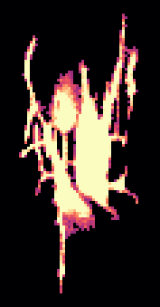
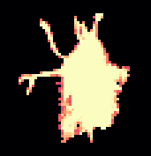
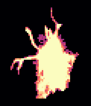
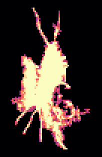
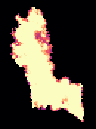
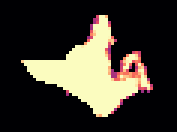
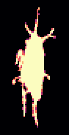
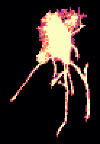
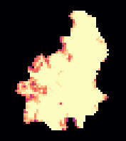

<!-- generated by scripts/build_pages.py from data/sample_4_1/; edits are overwritten -->

Voxel size 0.4471 µm (cubic) · volume 74 × 512 × 512 voxels (z, y, x) = 33 × 229 × 229 µm ·
exported 2026-10-07 from `Texas red 20min_24.8.2026.lif`.

Downloads: [osteocyte_props.csv](../data/sample_4_1/osteocyte_props.csv) · [dendrites.csv](../data/sample_4_1/dendrites.csv) · [summary.log](../data/sample_4_1/summary.log) · [summary.json](../data/sample_4_1/summary.json) · [scene.glb](../data/sample_4_1/scene.glb) · [scene_obj.zip](../data/sample_4_1/scene_obj.zip)

## 3D scene

Drag to rotate, scroll to zoom, right-drag to pan. One colour per osteocyte; cleaned ch0 nuclei inside the hull
(bone side) in translucent blue. Depth (z) points up. `scene_obj.zip` has the same scene as OBJ + MTL in µm,
with and without the nuclei.

```{=html}
<button class="btn btn-sm btn-outline-secondary nuclei-toggle" aria-pressed="true" data-target="scene" data-opacity="0.35">Nuclei: shown</button>
<model-viewer id="scene" src="../data/sample_4_1/scene.glb" alt="sample 4.1 osteocytes and nuclei" camera-controls touch-action="pan-y" interaction-prompt="none" shadow-intensity="0" exposure="1.1" class="scene-viewer" camera-orbit="0deg 35deg auto"></model-viewer>
```

## Pipeline counts

| stage | count |
|:--|--:|
| watershed regions | 29 |
| &gt;= 100 voxels and &gt; 0 vox inside xy hull (pass 1) | 20 |
| &gt; -6 vox inside hull without soft tissue (pass 2) | 20 |
| removed: far side of soft tissue | 2 |
| removed: no nucleus | 5 |
| split by nuclei | 0 |
| removed: flat | 0 |
| surviving osteocytes | 13 |
| nuclei (cleaned ch0) | 30 |
| inside hull, bone side | 23 |
| detected | 12 |
| soft tissue | 4 |
| labelled, rejected | 2 |
| no ch1 label | 5 |
| inside hull, not labelled as osteocyte (rejected + no ch1) | 7 |

## Osteocytes

```{=html}
<table class="datatable">
<thead><tr><th>label</th><th>volume (µm³)</th><th>surface (µm²)</th><th>axis 1 (µm)</th><th>axis 2 (µm)</th><th>axis 3 (µm)</th><th>flatness</th><th>nuclei</th><th>nucleus (µm³)</th><th>dendrites</th><th>reach mean (µm)</th><th>reach sd (µm)</th><th>reach max (µm)</th><th>path mean (µm)</th></tr></thead>
<tbody>
<tr><td>6</td><td>761</td><td>1519</td><td>31.52</td><td>17.85</td><td>8.20</td><td>0.46</td><td>1</td><td>105</td><td>7</td><td>6.90</td><td>5.19</td><td>14.95</td><td>29.08</td></tr>
<tr><td>10</td><td>855</td><td>1363</td><td>36.19</td><td>17.12</td><td>5.96</td><td>0.35</td><td>1</td><td>109</td><td>13</td><td>4.10</td><td>2.66</td><td>12.03</td><td>7.61</td></tr>
<tr><td>11</td><td>763</td><td>850</td><td>19.97</td><td>13.07</td><td>8.48</td><td>0.65</td><td>1</td><td>106</td><td>6</td><td>4.63</td><td>2.88</td><td>8.59</td><td>4.53</td></tr>
<tr><td>12</td><td>1097</td><td>1526</td><td>31.89</td><td>16.25</td><td>7.87</td><td>0.48</td><td>1</td><td>108</td><td>9</td><td>6.53</td><td>3.11</td><td>11.85</td><td>11.27</td></tr>
<tr><td>13</td><td>1462</td><td>1364</td><td>38.64</td><td>14.39</td><td>8.33</td><td>0.58</td><td>1</td><td>38.70</td><td>0</td><td></td><td></td><td></td><td></td></tr>
<tr><td>17</td><td>632</td><td>695</td><td>14.97</td><td>13.38</td><td>9.21</td><td>0.69</td><td>1</td><td>65.78</td><td>1</td><td>3.63</td><td></td><td>3.63</td><td>11.20</td></tr>
<tr><td>20</td><td>170</td><td>238</td><td>10.99</td><td>6.78</td><td>6.19</td><td>0.91</td><td>1</td><td>29.14</td><td>1</td><td>4.22</td><td></td><td>4.22</td><td>1.71</td></tr>
<tr><td>22</td><td>299</td><td>333</td><td>13.93</td><td>8.99</td><td>5.87</td><td>0.65</td><td>1</td><td>37.09</td><td>0</td><td></td><td></td><td></td><td></td></tr>
<tr><td>26</td><td>587</td><td>772</td><td>26.16</td><td>9.22</td><td>6.38</td><td>0.69</td><td>1</td><td>114</td><td>6</td><td>5.70</td><td>1.96</td><td>8.07</td><td>6.79</td></tr>
<tr><td>28</td><td>878</td><td>1435</td><td>29.07</td><td>14.77</td><td>10.53</td><td>0.71</td><td>1</td><td>82.40</td><td>10</td><td>8.08</td><td>7.58</td><td>21.85</td><td>11.08</td></tr>
<tr><td>29</td><td>1025</td><td>1041</td><td>26.62</td><td>15.61</td><td>6.55</td><td>0.42</td><td>1</td><td>41.47</td><td>1</td><td>2.41</td><td></td><td>2.41</td><td>0.45</td></tr>
<tr><td>30</td><td>493</td><td>732</td><td>31.61</td><td>7.61</td><td>6.59</td><td>0.87</td><td>1</td><td>90.45</td><td>4</td><td>5.45</td><td>3.56</td><td>10.70</td><td>11.61</td></tr>
<tr><td>32</td><td>451</td><td>661</td><td>20.90</td><td>10.54</td><td>6.07</td><td>0.58</td><td>1</td><td>51.03</td><td>5</td><td>4.24</td><td>1.71</td><td>6.15</td><td>5.48</td></tr>
</tbody>
</table>
```

## Gallery

Rotating maximum-intensity projections of ch1 inside each osteocyte. Click a cell for its 3D mesh.

```{=html}
<div class="gallery">
<figure class="cell-card" data-glb="../data/sample_4_1/cells/osteocyte_6.glb" data-title="osteocyte 6"><figcaption>#6 · 761 µm³ · 7 dendrites</figcaption></figure>
<figure class="cell-card" data-glb="../data/sample_4_1/cells/osteocyte_10.glb" data-title="osteocyte 10"><figcaption>#10 · 855 µm³ · 13 dendrites</figcaption></figure>
<figure class="cell-card" data-glb="../data/sample_4_1/cells/osteocyte_11.glb" data-title="osteocyte 11"><figcaption>#11 · 763 µm³ · 6 dendrites</figcaption></figure>
<figure class="cell-card" data-glb="../data/sample_4_1/cells/osteocyte_12.glb" data-title="osteocyte 12"><figcaption>#12 · 1097 µm³ · 9 dendrites</figcaption></figure>
<figure class="cell-card" data-glb="../data/sample_4_1/cells/osteocyte_13.glb" data-title="osteocyte 13"><figcaption>#13 · 1462 µm³ · 0 dendrites</figcaption></figure>
<figure class="cell-card" data-glb="../data/sample_4_1/cells/osteocyte_17.glb" data-title="osteocyte 17"><figcaption>#17 · 632 µm³ · 1 dendrites</figcaption></figure>
<figure class="cell-card" data-glb="../data/sample_4_1/cells/osteocyte_20.glb" data-title="osteocyte 20"><figcaption>#20 · 170 µm³ · 1 dendrites</figcaption></figure>
<figure class="cell-card" data-glb="../data/sample_4_1/cells/osteocyte_22.glb" data-title="osteocyte 22"><figcaption>#22 · 299 µm³ · 0 dendrites</figcaption></figure>
<figure class="cell-card" data-glb="../data/sample_4_1/cells/osteocyte_26.glb" data-title="osteocyte 26"><figcaption>#26 · 587 µm³ · 6 dendrites</figcaption></figure>
<figure class="cell-card" data-glb="../data/sample_4_1/cells/osteocyte_28.glb" data-title="osteocyte 28"><figcaption>#28 · 878 µm³ · 10 dendrites</figcaption></figure>
<figure class="cell-card" data-glb="../data/sample_4_1/cells/osteocyte_29.glb" data-title="osteocyte 29"><figcaption>#29 · 1025 µm³ · 1 dendrites</figcaption></figure>
<figure class="cell-card" data-glb="../data/sample_4_1/cells/osteocyte_30.glb" data-title="osteocyte 30"><figcaption>#30 · 493 µm³ · 4 dendrites</figcaption></figure>
<figure class="cell-card" data-glb="../data/sample_4_1/cells/osteocyte_32.glb" data-title="osteocyte 32"><figcaption>#32 · 451 µm³ · 5 dendrites</figcaption></figure>
</div>
<dialog id="cell-dialog"><form method="dialog"><button class="close" aria-label="close">×</button></form>
<h3 class="cell-title"></h3><model-viewer camera-controls interaction-prompt="none" shadow-intensity="0" class="cell-viewer"></model-viewer></dialog>
```
