<!-- generated by scripts/build_pages.py from data/smple_1_2/; edits are overwritten -->

Voxel size 0.4815 µm (cubic) · volume 48 × 512 × 512 voxels (z, y, x) = 23 × 247 × 247 µm ·
exported 2026-10-07 from `Texas red 20min_24.8.2026.lif`.

Downloads: [osteocyte_props.csv](../data/smple_1_2/osteocyte_props.csv) · [dendrites.csv](../data/smple_1_2/dendrites.csv) · [summary.log](../data/smple_1_2/summary.log) · [summary.json](../data/smple_1_2/summary.json) · [scene.glb](../data/smple_1_2/scene.glb) · [scene_obj.zip](../data/smple_1_2/scene_obj.zip)

## 3D scene

Drag to rotate, scroll to zoom, right-drag to pan. One colour per osteocyte; cleaned ch0 nuclei inside the hull
(bone side) in translucent blue. Depth (z) points up. `scene_obj.zip` has the same scene as OBJ + MTL in µm,
with and without the nuclei.

```{=html}
<button class="btn btn-sm btn-outline-secondary nuclei-toggle" aria-pressed="true" data-target="scene" data-opacity="0.35">Nuclei: shown</button>
<model-viewer id="scene" src="../data/smple_1_2/scene.glb" alt="smple 1.2 osteocytes and nuclei" camera-controls touch-action="pan-y" interaction-prompt="none" shadow-intensity="0" exposure="1.1" class="scene-viewer" camera-orbit="0deg 35deg auto"></model-viewer>
```

## Pipeline counts

| stage | count |
|:--|--:|
| watershed regions | 79 |
| &gt;= 100 voxels and &gt; 5 vox inside xy hull (pass 1) | 51 |
| &gt; 0 vox inside hull without soft tissue (pass 2) | 40 |
| removed: far side of soft tissue | 0 |
| removed: no nucleus | 19 |
| split by nuclei | 1 |
| removed: flat | 7 |
| surviving osteocytes | 15 |
| nuclei (cleaned ch0) | 57 |
| inside hull, bone side | 42 |
| detected | 15 |
| soft tissue | 1 |
| labelled, rejected | 16 |
| no ch1 label | 10 |
| inside hull, not labelled as osteocyte (rejected + no ch1) | 26 |

## Osteocytes

```{=html}
<table class="datatable">
<thead><tr><th>label</th><th>volume (µm³)</th><th>surface (µm²)</th><th>axis 1 (µm)</th><th>axis 2 (µm)</th><th>axis 3 (µm)</th><th>flatness</th><th>nuclei</th><th>nucleus (µm³)</th><th>dendrites</th><th>reach mean (µm)</th><th>reach sd (µm)</th><th>reach max (µm)</th><th>path mean (µm)</th></tr></thead>
<tbody>
<tr><td>3</td><td>1146</td><td>1461</td><td>37.81</td><td>15.26</td><td>7.03</td><td>0.46</td><td>1</td><td>78.69</td><td>5</td><td>3.53</td><td>1.49</td><td>5.21</td><td>7.84</td></tr>
<tr><td>24</td><td>893</td><td>1199</td><td>26.75</td><td>17.44</td><td>7.11</td><td>0.41</td><td>1</td><td>106</td><td>6</td><td>3.13</td><td>1.28</td><td>5.00</td><td>5.22</td></tr>
<tr><td>28</td><td>1202</td><td>1615</td><td>31.41</td><td>13.67</td><td>9.18</td><td>0.67</td><td>1</td><td>31.59</td><td>4</td><td>2.84</td><td>1.34</td><td>4.84</td><td>10.36</td></tr>
<tr><td>43</td><td>830</td><td>1495</td><td>49.20</td><td>16.32</td><td>7.85</td><td>0.48</td><td>1</td><td>49.33</td><td>7</td><td>8.70</td><td>6.05</td><td>19.85</td><td>21.74</td></tr>
<tr><td>46</td><td>1979</td><td>2609</td><td>38.87</td><td>21.36</td><td>12.40</td><td>0.58</td><td>1</td><td>46.10</td><td>20</td><td>5.09</td><td>3.01</td><td>13.04</td><td>7.24</td></tr>
<tr><td>47</td><td>2173</td><td>2445</td><td>30.83</td><td>15.19</td><td>13.92</td><td>0.92</td><td>1</td><td>41.97</td><td>8</td><td>4.50</td><td>2.77</td><td>9.50</td><td>14.47</td></tr>
<tr><td>48</td><td>1339</td><td>1910</td><td>51.75</td><td>14.39</td><td>5.80</td><td>0.40</td><td>1</td><td>101</td><td>6</td><td>4.26</td><td>3.17</td><td>10.61</td><td>11.59</td></tr>
<tr><td>51</td><td>1189</td><td>1704</td><td>36.90</td><td>11.73</td><td>10.13</td><td>0.86</td><td>1</td><td>42.41</td><td>11</td><td>5.82</td><td>4.75</td><td>15.92</td><td>8.16</td></tr>
<tr><td>52</td><td>1173</td><td>1377</td><td>33.93</td><td>16.01</td><td>7.03</td><td>0.44</td><td>1</td><td>48.89</td><td>4</td><td>2.80</td><td>0.98</td><td>4.25</td><td>6.70</td></tr>
<tr><td>54</td><td>1440</td><td>2197</td><td>51.46</td><td>16.04</td><td>9.63</td><td>0.60</td><td>1</td><td>44.42</td><td>13</td><td>6.40</td><td>3.65</td><td>13.83</td><td>11.91</td></tr>
<tr><td>58</td><td>2145</td><td>2819</td><td>36.67</td><td>19.34</td><td>12.55</td><td>0.65</td><td>1</td><td>45.76</td><td>19</td><td>3.90</td><td>3.00</td><td>14.49</td><td>7.02</td></tr>
<tr><td>62</td><td>467</td><td>573</td><td>23.96</td><td>7.77</td><td>5.77</td><td>0.74</td><td>1</td><td>42.75</td><td>5</td><td>3.09</td><td>1.26</td><td>5.32</td><td>3.18</td></tr>
<tr><td>68</td><td>1086</td><td>1774</td><td>41.09</td><td>13.12</td><td>10.31</td><td>0.79</td><td>1</td><td>35.16</td><td>9</td><td>7.57</td><td>3.40</td><td>14.46</td><td>17.13</td></tr>
<tr><td>83</td><td>3599</td><td>3828</td><td>37.18</td><td>23.51</td><td>14.35</td><td>0.61</td><td>1</td><td>49.11</td><td>16</td><td>4.21</td><td>2.56</td><td>9.51</td><td>8.20</td></tr>
<tr><td>84</td><td>2138</td><td>2887</td><td>53.38</td><td>16.50</td><td>12.31</td><td>0.75</td><td>1</td><td>38.39</td><td>13</td><td>5.96</td><td>5.33</td><td>20.34</td><td>7.90</td></tr>
</tbody>
</table>
```

## Gallery

Rotating maximum-intensity projections of ch1 inside each osteocyte. Click a cell for its 3D mesh.

```{=html}
<div class="gallery">
<figure class="cell-card" data-glb="../data/smple_1_2/cells/osteocyte_3.glb" data-title="osteocyte 3">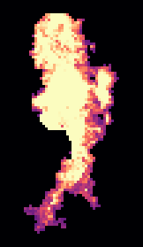<figcaption>#3 · 1146 µm³ · 5 dendrites</figcaption></figure>
<figure class="cell-card" data-glb="../data/smple_1_2/cells/osteocyte_24.glb" data-title="osteocyte 24">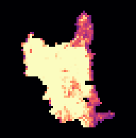<figcaption>#24 · 893 µm³ · 6 dendrites</figcaption></figure>
<figure class="cell-card" data-glb="../data/smple_1_2/cells/osteocyte_28.glb" data-title="osteocyte 28">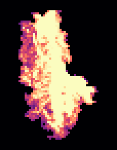<figcaption>#28 · 1202 µm³ · 4 dendrites</figcaption></figure>
<figure class="cell-card" data-glb="../data/smple_1_2/cells/osteocyte_43.glb" data-title="osteocyte 43">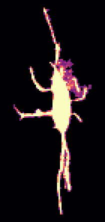<figcaption>#43 · 830 µm³ · 7 dendrites</figcaption></figure>
<figure class="cell-card" data-glb="../data/smple_1_2/cells/osteocyte_46.glb" data-title="osteocyte 46">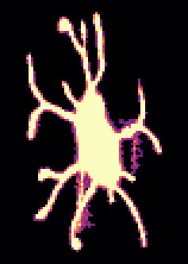<figcaption>#46 · 1979 µm³ · 20 dendrites</figcaption></figure>
<figure class="cell-card" data-glb="../data/smple_1_2/cells/osteocyte_47.glb" data-title="osteocyte 47"><figcaption>#47 · 2173 µm³ · 8 dendrites</figcaption></figure>
<figure class="cell-card" data-glb="../data/smple_1_2/cells/osteocyte_48.glb" data-title="osteocyte 48">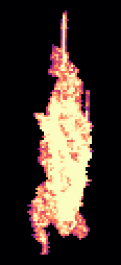<figcaption>#48 · 1339 µm³ · 6 dendrites</figcaption></figure>
<figure class="cell-card" data-glb="../data/smple_1_2/cells/osteocyte_51.glb" data-title="osteocyte 51">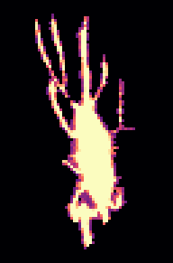<figcaption>#51 · 1189 µm³ · 11 dendrites</figcaption></figure>
<figure class="cell-card" data-glb="../data/smple_1_2/cells/osteocyte_52.glb" data-title="osteocyte 52">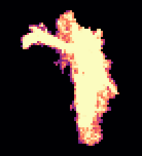<figcaption>#52 · 1173 µm³ · 4 dendrites</figcaption></figure>
<figure class="cell-card" data-glb="../data/smple_1_2/cells/osteocyte_54.glb" data-title="osteocyte 54">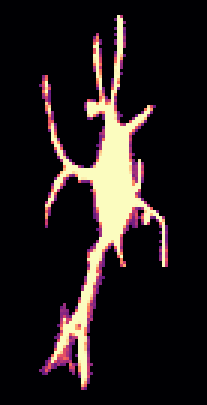<figcaption>#54 · 1440 µm³ · 13 dendrites</figcaption></figure>
<figure class="cell-card" data-glb="../data/smple_1_2/cells/osteocyte_58.glb" data-title="osteocyte 58"><figcaption>#58 · 2145 µm³ · 19 dendrites</figcaption></figure>
<figure class="cell-card" data-glb="../data/smple_1_2/cells/osteocyte_62.glb" data-title="osteocyte 62"><figcaption>#62 · 467 µm³ · 5 dendrites</figcaption></figure>
<figure class="cell-card" data-glb="../data/smple_1_2/cells/osteocyte_68.glb" data-title="osteocyte 68">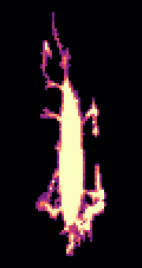<figcaption>#68 · 1086 µm³ · 9 dendrites</figcaption></figure>
<figure class="cell-card" data-glb="../data/smple_1_2/cells/osteocyte_83.glb" data-title="osteocyte 83">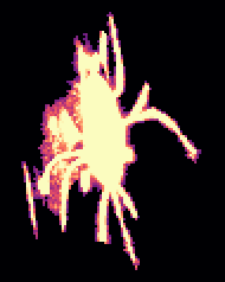<figcaption>#83 · 3599 µm³ · 16 dendrites</figcaption></figure>
<figure class="cell-card" data-glb="../data/smple_1_2/cells/osteocyte_84.glb" data-title="osteocyte 84">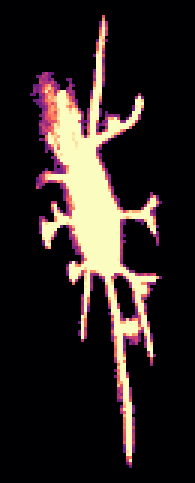<figcaption>#84 · 2138 µm³ · 13 dendrites</figcaption></figure>
</div>
<dialog id="cell-dialog"><form method="dialog"><button class="close" aria-label="close">×</button></form>
<h3 class="cell-title"></h3><model-viewer camera-controls interaction-prompt="none" shadow-intensity="0" class="cell-viewer"></model-viewer></dialog>
```
